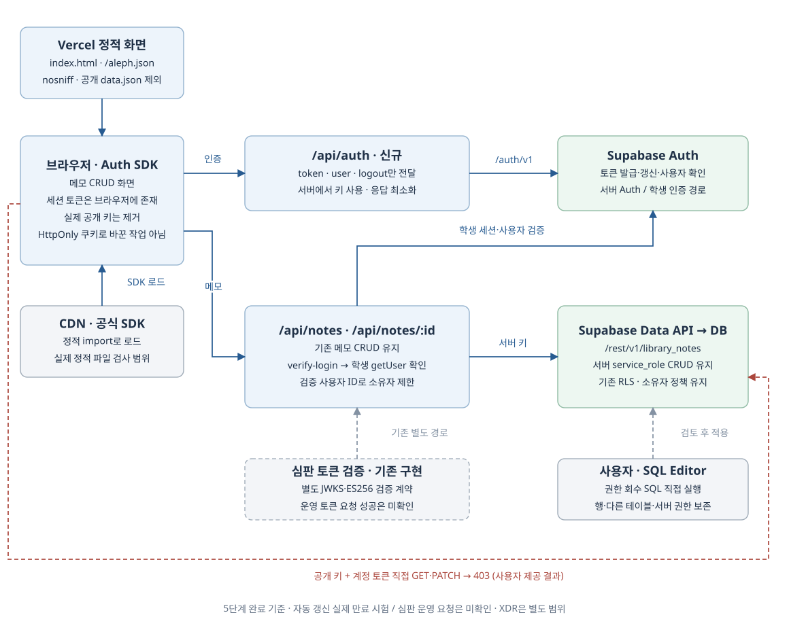
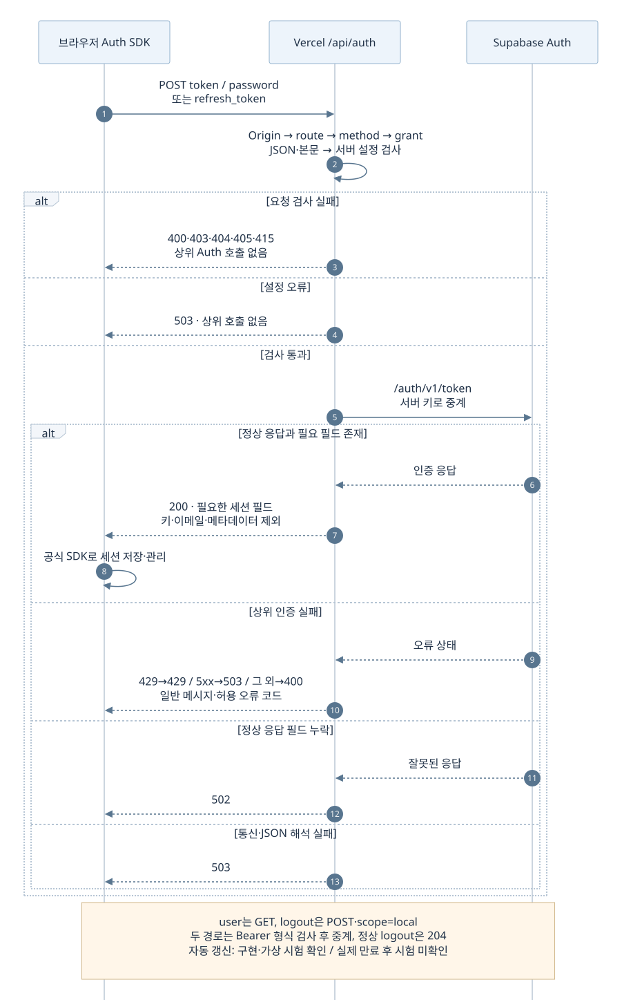
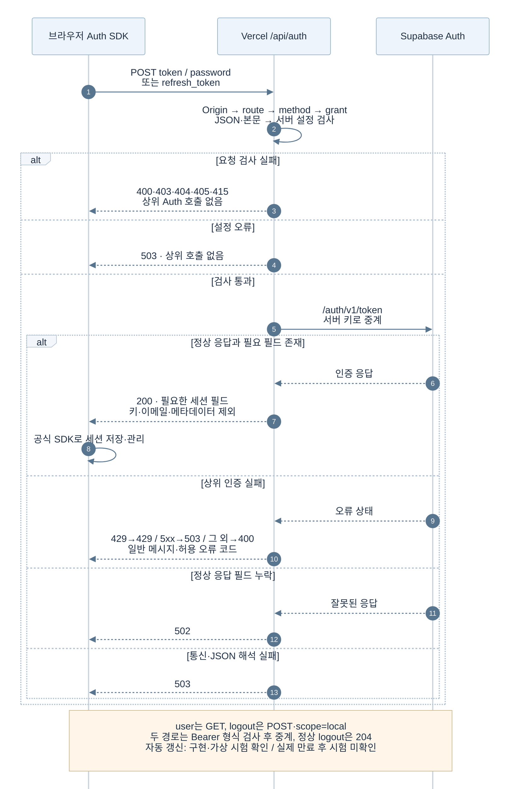
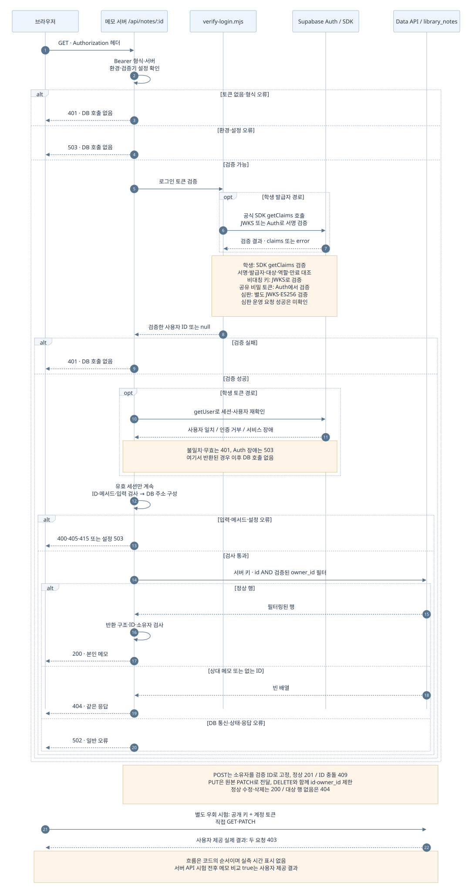
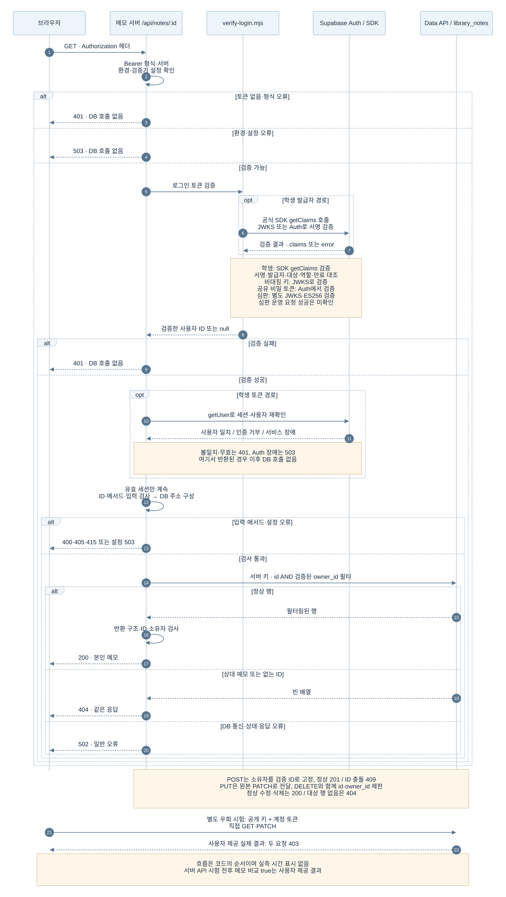

# 5단계 작업 기록: 자료 요청을 서버 한곳으로 모읍니다

기준: 2026-10-07 5단계 완료 및 원본 주소 누락 수정. 문서 정리: 2026-10-12.

수정용 Markdown입니다. 전체 읽기용 문서는 [작업정리.html](작업정리.html)입니다. 문서와 diagrams/를 함께 복사하면 본문·그림은 오프라인에서 볼 수 있습니다.

## 작업 목표와 실제 수행 범위

4단계 화면은 이미 메모를 `/api/notes`로 처리했습니다. 그러나 로그인 토큰과 공개 키로 Supabase 원본 자료 API를 직접 호출할 수 있는 권한이 남아 있었습니다. 5단계에서는 이 우회 경로를 닫고 정상적인 본인 메모 처리를 유지했습니다.

### 실제로 변경한 부분

- `public.library_notes`의 PUBLIC·anon·authenticated 테이블·열 권한 회수 SQL을 작성했습니다. 사용자가 학습 DB에서 적용했습니다.
- 화면의 실제 Supabase 공개 키를 제거하고 기존 Auth SDK의 요청을 신규 `/api/auth`로 연결했습니다.
- 단계 설정·배포 식별 JSON·학생 자기 점검·시험 기준표를 갱신했습니다.
- 심판에서 발견한 배포 JSON의 `originalApiUrl` 누락을 수정했습니다.

### 확인하고 유지한 부분

- 브라우저의 직접 메모 DB 호출: **없음**. 메모 CRUD 서버 호출로 새로 전환한 작업은 없습니다.
- 기존 서버의 로그인 검증·세션 확인·소유자 필터·입력 검사를 유지했습니다.
- 기존 RLS와 소유자 정책 네 개, 서버 역할의 CRUD 권한을 유지했습니다.
- `vercel.json`의 기존 nosniff 헤더와 메모 상세 경로 연결을 확인했습니다.

### 과제의 기본 조건과 추가 점수

| 구분 | 요구사항 | 대응 |
| --- | --- | --- |
| 기본 70점 조건 | 공개 키·시험 계정 토큰으로 원본 API 직접 조회·수정 방어, 공개 정적 파일·묶음에서 서버 키·시드 표식 미노출 | 권한 회수, 실제 직접 GET·PATCH 거부 확인, 공개 파일 검사. 실제 심판 점수와는 별도입니다. |
| 추가 10점 | `/aleph.json`의 `allowedRoutes`에 허용 경로 존재 | 기존 메모 API 다섯 경로 유지·배포 JSON 출력 및 확인 |
| 추가 10점 | 첫 화면 보안 헤더 nosniff 또는 CSP | 기존 nosniff 유지·실제 응답 확인 |
| 추가 10점 | 화면 코드에 실제 Supabase 공개 키 없음 | Auth 서버 연결과 공개 화면·정적 import 파일 검사 |

이번 문서 작성에서는 코드·설정·DB를 변경하지 않았습니다. XDR 기능과 후속 Git 이력 정리는 별도 기록으로 연결하며, 5단계의 새 기능으로 합산하지 않습니다.

## 전체 서비스 구성

메모와 인증 요청은 Vercel 서버 함수를 거칩니다. 화면 파일과 SDK는 정적 파일로 내려받습니다. “서버 함수만 호출한다”는 조건은 메모 자료 요청에 적용되며, SDK를 받는 CDN 요청까지 없다는 뜻은 아닙니다.



실선은 구현과 실제 확인 기록을 함께 확인한 경로입니다. 토큰 자동 갱신은 코드·가상 시험이 있으나 배포에서 만료까지 기다린 시험은 하지 않았습니다. 점선 심판 경로를 실제 심판의 모든 검사가 성공했다는 근거로 사용하지 않습니다.

[SVG 크게 보기](diagrams/service-overview.svg) · [편집 원본](diagrams/service-overview.drawio)

정적 배포·서버 함수 실행 설정은 [vercel.json](../vercel.json), 인증 검증은 [verify-login.mjs](../src/verify-login.mjs), SQL 적용은 [권한 회수 SQL](../docs/sql/stage5-library-notes-apply.sql)에서 확인할 수 있습니다. 현재 파일에는 후속 작업이 있을 수 있으므로 5단계 상태는 아래 저장점과 함께 읽습니다.

## 요청과 응답 순서

### 로그인: SDK의 요청 주소를 서버 함수로 연결



응답에 access/refresh 토큰이 포함되는 것은 정상 로그인에 필요한 동작입니다. 키를 브라우저에서 제거한 조치를 “브라우저에 토큰도 없다”거나 “HttpOnly 쿠키 인증으로 변경했다”고 해석하지 않습니다. 갱신은 refresh_token, 사용자 조회는 GET user, 로그아웃은 POST logout·scope=local 경로를 사용합니다.

[SVG 크게 보기](diagrams/login-sequence.svg) · [편집 원본](diagrams/login-sequence.mmd)



### 메모: 인증 후 사용자 ID와 메모 ID를 함께 제한



상대 메모 GET 404는 없는 메모와 같은 응답을 사용합니다. 주소창으로 여는 요청은 화면 SDK의 Authorization 헤더가 자동으로 붙지 않아, A가 화면에 로그인해 있어도 401이 나올 수 있습니다. 이는 A의 인증된 요청이 실패했다는 증거가 아닙니다.

[SVG 크게 보기](diagrams/notes-sequence.svg) · [편집 원본](diagrams/notes-sequence.mmd)



| 화면에서 보낸 요청 | 서버의 원본 요청 | 정상 응답 |
| --- | --- | --- |
| GET /api/notes | GET · 검증한 owner_id로 목록 필터 | 200 · 본인 메모 목록 |
| POST /api/notes | POST · owner_id를 검증 ID로 고정 | 201 · 생성된 ID |
| GET /api/notes/:id | GET · id + owner_id 필터 | 200 · 본인 메모 한 건 |
| PUT /api/notes/:id | PATCH · id + owner_id 필터 | 200 · 변경된 본인 메모 |
| DELETE /api/notes/:id | DELETE · id + owner_id 필터 | 200 · 삭제된 ID |

## 주요 판단 로직

호출 관계는 앞의 그림으로 설명하고, 조건과 분기는 이 표로 정리했습니다. 상태 숫자는 코드의 동작이며 실제 시험 여부는 검증 표에서 별도로 표시합니다.

| 판단 위치 | 조건 | 처리와 의미 | 5단계 작업 성격 |
| --- | --- | --- | --- |
| 메모 서버 입구 | Bearer 형식·로그인 검증 불통과 | 401. 무인증 요청은 DB 전 단계에서 중단합니다. | 기존 방어 유지 |
| 학생 세션 검증 | 서명은 맞지만 Auth 사용자·세션이 유효하지 않음 | 401. Auth 서비스 장애는 503. 심판 토큰은 기존 별도 검증 경로입니다. | 기존 방어 유지 |
| 입력 검사 | 잘못된 UUID·JSON·필드 / 지원하지 않는 방식·형식 | 400 / 405 / 415. 본문에 소유자를 넣어 바꾸려는 시도도 거부합니다. | 기존 방어 확인 |
| 메모 소유권 | 요청한 ID와 검증된 사용자 ID가 함께 맞는 행 없음 | 상세 읽기·수정·삭제 404. 상대 행의 존재를 구별해 알려주지 않습니다. | 기존 방어 유지·실제 확인 |
| DB 결과 검사 | 반환 행의 소유자·ID·구조가 기대와 다름 | 502·일반 오류. DB 응답을 그대로 믿고 화면에 내리지 않습니다. | 기존 방어 확인 |
| Auth 서버 | 허용 경로·메서드·Origin·grant·본문 검사 | token/user/logout만 전달. password/refresh_token만 허용. Origin 헤더가 있을 때 정해진 출처와 대조합니다. | 신규 Auth 경계 제한 |
| Auth 응답 | 상위 오류 또는 정상 응답의 필요 필드 누락 | 일반 오류와 허용 코드로 제한. 상위 429→429, 5xx→503, 그 외 실패→400. 잘못된 정상 응답→502. | 신규 오류·응답 최소화 |
| 권한 회수 SQL | 회수 후 테이블·열·상속 권한 남음 / 서버 ACL 변동·CRUD 누락 | 예외로 트랜잭션 중단. 정상 조건에서 COMMIT. 오류 시 ROLLBACK 안내. | 신규 적용 보호 |
| 배포 JSON 생성 | 5단계 이상에서 원본 주소 누락·HTTP·쿼리·인증정보·fragment 포함 | 빌드 오류로 중단. 올바른 HTTPS 경로는 originalApiUrl로 출력합니다. | 심판 오류 후 누락 수정 |

`originalApiUrl`은 심판이 직접 접근 검사를 보낼 주소입니다. 이 필드가 없으면 직접 접근 차단이 되어 있어도 검사 대상이 전달되지 않습니다. 주소를 적는 것 자체가 DB 접근 권한을 부여하거나 회수하지는 않습니다. 실제 값은 [설정 파일](../aleph.config.json)에서 확인하고, 이 문서에는 키·토큰·계정 ID를 복제하지 않습니다.

## 파일별 역할과 변경 이유

“작업 전”은 4단계 인수 기준, “작업 후”는 5단계 완료와 원본 주소 누락 수정까지입니다. 현재 파일의 후속 XDR 변경을 5단계 변경으로 포함하지 않았습니다.

| 파일명 | 기존 역할 (4단계 인수 기준) | 5단계 완료 당시 역할 | 추가·변경 이유 |
| --- | --- | --- | --- |
| [api/auth.js](../api/auth.js) | <span style="display:inline-block;padding:2px 10px;border-radius:999px;background:#edf5ff;border:1px solid #b7d0ec;color:#37658f;font-size:12px;">신규</span> | 허용한 Auth 요청을 서버에서 전달·응답 최소화 | 화면 공개 키 제거·기존 SDK 인증 동작 유지 |
| [public/index.html](../public/index.html) | 서버 메모 CRUD + 공개 키를 사용한 직접 Auth | 메모 서버 호출 유지, Auth를 /api/auth로 전달 | 실제 공개 키 제거·SDK 유지·세션 저장 키 변경으로 새 배포 재로그인 |
| [stage5-library-notes-apply.sql](../docs/sql/stage5-library-notes-apply.sql) | <span style="display:inline-block;padding:2px 10px;border-radius:999px;background:#edf5ff;border:1px solid #b7d0ec;color:#37658f;font-size:12px;">신규</span> | 해당 테이블·열 권한 회수와 트랜잭션 검증 | 서버를 우회하는 직접 접근 차단·서버 역할 보호 |
| [stage5-library-notes-audit.sql](../docs/sql/stage5-library-notes-audit.sql) | <span style="display:inline-block;padding:2px 10px;border-radius:999px;background:#edf5ff;border:1px solid #b7d0ec;color:#37658f;font-size:12px;">신규</span> | 명시 권한·실효 권한·열 ACL·RLS·정책·서버 CRUD 조회 | 적용 전후 같은 기준으로 비교, PUBLIC·상속·열 권한 누락 방지 |
| [aleph.config.json](../aleph.config.json) | 4단계·배포와 발급자·허용 경로 설정 | 5단계 및 쿼리 없는 originalApiUrl 추가 | 단계·검사 대상 명시. 기존 judgeIssuer·발급자·경로 유지 |
| [deployment-identity.mjs](../scripts/deployment-identity.mjs) | 배포 /aleph.json 식별 항목 생성 | 5단계 allowedRoutes 출력, 후속 수정으로 originalApiUrl 검증·출력 | 로컬 설정을 심판이 읽는 실제 배포 JSON으로 전달 |
| [src/attack-check.mjs](../src/attack-check.mjs) | 이전 단계 공개 HTTP 자기 점검 | 5단계 공개 HTTP·첫 화면 검사 및 원본 주소 일치 확인 | 실제로 보낸 요청만 결과에 기록. 계정·원본 인증 시험을 자동 완료로 쓰지 않음 |
| [test/auth.test.mjs](../test/auth.test.mjs) | <span style="display:inline-block;padding:2px 10px;border-radius:999px;background:#edf5ff;border:1px solid #b7d0ec;color:#37658f;font-size:12px;">신규</span> | Auth 프록시와 실제 SDK의 가상 로그인·갱신·user·logout 시험 | 키 미전달·제한된 응답·SDK 호환 확인 |
| [test/r5.test.mjs](../test/r5.test.mjs) | 정적 빌드·배포 식별 시험 | 허용 경로·원본 주소 출력 및 잘못된 주소 거부 시험 | originalApiUrl 누락 재발 방지 |
| [baseline-functions.json](../package/baseline-functions.json)<br>[package-starter.test.mjs](../test/package-starter.test.mjs) | 실제 메모·Auth API가 빠진 기준표·검사 | 존재하는 서버 함수와 동적 메모 경로를 반영 | 전체 시험 첫 실패의 기준표 불일치 수정 |
| [api/notes.js](../api/notes.js)<br>[api/notes/[id].js](../api/notes/[id].js)<br>[verify-login.mjs](../src/verify-login.mjs) | 로그인·세션·소유자 검사와 메모 CRUD | 기존 구현 유지 | 정상 A 처리와 B·무로그인 거부가 권한 회수 후에도 유지되는지 확인코드 수정 없이 확인만 했습니다. |
| [vercel.json](../vercel.json) | nosniff·정적 배포·메모 상세 rewrite | 기존 설정 유지 | 보안 헤더 조건은 이미 충족, 실제 HTTP로 확인코드 수정 없이 확인만 했습니다. |
| [build-public.mjs](../scripts/build-public.mjs)<br>[bundle.mjs](../scripts/bundle.mjs) | 정적 자료 제외·배포 JSON 생성 / 제출 JSON 생성 | 기존 실행 경로 유지. 수정된 식별 생성 함수를 사용 | 로컬 빌드·배포·제출 각각의 범위를 구분 |
| [src/decider.mjs](../src/decider.mjs) | 기본 거부 규칙 starter.deny | 5단계에서 기존 규칙 유지 | 실제 구현된 규칙만 제출. 메모 요청의 운영 판단 경로로 연결했다고 주장하지 않음코드 수정 없이 확인만 했습니다. |
| [README.md](../README.md) | 현재 안내와 단계 기록이 섞여 있던 루트 문서 | 현재 기능·실행 방법·단계 목차 | 사용자 요청에 따라 현재 상태와 과거 기록 구분 |
| [TODO.md](../TODO.md) | <span style="display:inline-block;padding:2px 10px;border-radius:999px;background:#edf5ff;border:1px solid #b7d0ec;color:#37658f;font-size:12px;">신규</span> | 미완료 목표·미반영·미확인 항목 관리 | 목표가 누적돼도 완료 작업 기록과 구분 |
| [5/README.md](README.md) | <span style="display:inline-block;padding:2px 10px;border-radius:999px;background:#edf5ff;border:1px solid #b7d0ec;color:#37658f;font-size:12px;">신규</span> | 5단계 시간순 작업·실제 확인 기록 | 완료 작업과 후속 결과의 시점 보존 |
| [4/README.md](../4/README.md)<br>[docs/requests/stage5.txt](../docs/requests/stage5.txt) | 4단계 문서·요청이 여러 위치에 존재 | 기존 4단계 원문 보존·5단계 요청 원문 분리 | 단계 기록과 실행용 SQL 구분, 과거 기록 보존 |
| [.gitignore](../.gitignore) | 기존 비밀·제출 산출물 제외 | 5단계 캡처 등 로컬 보관 범위를 제외 | 캡처와 산출물을 Git에 포함하지 않음. 후속 data.json 이력 제거와 구분 |
| 학습 DB public.library_notes | authenticated SELECT·INSERT·UPDATE·DELETE 허용 | 직접 역할 테이블·열 실효 권한 false | 행·다른 테이블·기존 RLS 정책·서버 CRUD 보존 |
| [artifacts/stage5-public-checks.json](../artifacts/stage5-public-checks.json) | <span style="display:inline-block;padding:2px 10px;border-radius:999px;background:#edf5ff;border:1px solid #b7d0ec;color:#37658f;font-size:12px;">신규</span> 실행 산출물 | 공개 HTTP 자기 점검 결과 | 실제로 보낸 공개 요청의 상태만 기록 |
| [artifacts/stage5-asset-scan.json](../artifacts/stage5-asset-scan.json) | <span style="display:inline-block;padding:2px 10px;border-radius:999px;background:#edf5ff;border:1px solid #b7d0ec;color:#37658f;font-size:12px;">신규</span> 실행 산출물 | 10개 정적 파일 검색 결과 | 자기 점검의 첫 화면 검색과 별도로 외부 정적 import 범위 확인 |
| [artifacts/stage5-original-check.json](../artifacts/stage5-original-check.json) | <span style="display:inline-block;padding:2px 10px;border-radius:999px;background:#edf5ff;border:1px solid #b7d0ec;color:#37658f;font-size:12px;">신규</span> 실행 산출물 | 공개 키만 사용한 원본 조회 결과 | 이른 시점의 401·미반환 기록. 후속 사용자 인증 시험과 시점 구분 |
| [artifacts/submission.json](../artifacts/submission.json) | <span style="display:inline-block;padding:2px 10px;border-radius:999px;background:#edf5ff;border:1px solid #b7d0ec;color:#37658f;font-size:12px;">신규</span> 실행 산출물 | 제출 JSON·자기 점검 기록 | Git 제외, 후속 제출에 따라 덮어쓰일 수 있어 고정 5단계 근거로 취급하지 않음 |

“확인만”인 파일을 신규 보안 구현으로 세지 않습니다. 표에 있는 코드 파일은 이번 문서 정리에서 수정하지 않았습니다.

### 이번 문서 정리에서 작성·갱신한 파일

아래 기존 역할은 2026-10-12 문서 개편 직전 기준입니다. 앞 표의 4단계 인수 기준과 구분합니다.

| 문서 파일명 | 기존 역할 | 현재 역할 | 추가·변경 이유 |
| --- | --- | --- | --- |
| 작업정리.md | <span style="display:inline-block;padding:2px 10px;border-radius:999px;background:#edf5ff;border:1px solid #b7d0ec;color:#37658f;font-size:12px;">신규</span> | 전체 작업 기록의 수정 원본 | 기존 문서·구현·검증 근거를 편집 가능한 Markdown으로 작성 |
| 작업정리.html | 기존 전체 HTML, 상단 목차·내장 SVG | 사이드바 목차·로컬 그림·파일 표·재현 안내 | 새 문서 요구에 맞춰 읽기 편한 전체 HTML로 갱신 |
| 작업정리-이전.html | <span style="display:inline-block;padding:2px 10px;border-radius:999px;background:#edf5ff;border:1px solid #b7d0ec;color:#37658f;font-size:12px;">신규</span> | 이전 HTML 보존 사본 | 과거 정리본을 삭제하거나 덮어써 없애지 않도록 보존 |
| diagrams/service-overview.drawio | <span style="display:inline-block;padding:2px 10px;border-radius:999px;background:#edf5ff;border:1px solid #b7d0ec;color:#37658f;font-size:12px;">신규</span> | 편집 가능한 구성도 원본 | 도형·텍스트·연결 정보를 draw.io XML로 보관 |
| diagrams/login-sequence.mmd · notes-sequence.mmd | <span style="display:inline-block;padding:2px 10px;border-radius:999px;background:#edf5ff;border:1px solid #b7d0ec;color:#37658f;font-size:12px;">신규</span> | Mermaid 시퀀스 원본 | 실제 코드의 호출·응답·거부 순서를 편집 가능하게 표현 |
| diagrams/*.svg | <span style="display:inline-block;padding:2px 10px;border-radius:999px;background:#edf5ff;border:1px solid #b7d0ec;color:#37658f;font-size:12px;">신규</span> 실행 산출물 | 오프라인 HTML에서 사용하는 그림 3개 | 구성도와 Mermaid 시퀀스를 로컬 SVG로 렌더링 |
| diagrams/mermaid-theme.json · README.md | <span style="display:inline-block;padding:2px 10px;border-radius:999px;background:#edf5ff;border:1px solid #b7d0ec;color:#37658f;font-size:12px;">신규</span> | 테마 설정·원본 수정·재생성 안내 | 그림 색·폰트·간격과 이동·편집 방법 통일 |
| diagrams/문서검증.json · 검증-*.png | <span style="display:inline-block;padding:2px 10px;border-radius:999px;background:#edf5ff;border:1px solid #b7d0ec;color:#37658f;font-size:12px;">신규</span> 실행 산출물 | HTML·SVG 렌더링 검증 결과·화면 | 배지 위치·이미지 로딩·표 배치·한글·SVG 경계를 확인한 근거 |
| 5/README.md | 기존 시간순 작업 기록·종합 HTML 링크 | 기존 기록 유지·새 문서와 그림 안내 추가 | 읽기용 문서와 수정 원본을 찾을 수 있도록 링크만 추가 |

## 검증 결과와 저장점

아래 실행·검증은 5단계 당시 기록입니다. 2026-10-12 이번 문서 작성에서는 문서와 코드·Git 기록을 읽어 대조했으며, 빌드·계정 시험·DB SQL·배포·bundle을 새로 실행하지 않았습니다.

### 실행한 명령과 결과

| 실행 / 방법 | 구분 | 기록된 결과 | 확인의 한계 |
| --- | --- | --- | --- |
| `npm run build -- --local`<br>Windows에서는 `npm.cmd run build -- --local` | 실제 로컬 실행 | 성공. 공개 data.json 제외·이전 빌드 파일 제거 | PowerShell의 npm.ps1 정책 오류는 npm.cmd 사용으로 해결. --local은 실제 배포 JSON·DB 시험이 아닙니다. |
| `node --test test/notes.test.mjs test/notes-ui.test.mjs test/r5.test.mjs` | 가상 시험 | 폴더 정리 후 기존 시험 27개 통과 | 폴더 정리로 기능이 깨지지 않는지 확인한 시점 |
| `node --test test/auth.test.mjs test/notes.test.mjs test/notes-ui.test.mjs test/r5.test.mjs test/package-starter.test.mjs test/xdr-run.test.mjs` | 가상 시험 | 코드·SQL 준비 후 35개 통과 | 실제 SDK + 가상 Auth 응답 포함. xdr-run 시험 통과는 운영 XDR 연결 증거가 아닙니다. |
| `node --test test/r5.test.mjs` | 가상 시험 | 원본 주소 누락 수정 후 3개 통과 | 배포 JSON 출력·잘못된 주소 거부 확인. 실제 DB 직접 요청과는 별도 |
| Supabase SQL Editor: 조회 → 회수 SQL → 같은 조회 | 사용자 실행·화면 | 회수 성공, 적용 후 일곱 조회 결과 확인 | 도구가 학습 DB SQL을 대신 실행한 작업으로 기록하지 않음 |
| 실제 HTTPS 요청·브라우저 콘솔·정적 import 추적 | 실제 서비스 확인 | 다음 결과표 참고 | 첫 시도 네 요청 실패 및 /aleph.json 브라우저 차단 후, 후속 읽기 점검에서 확인 완료. 실패 기록도 보존 |
| `git commit -m "5단계 저장점"`<br>`git push origin main`<br>`npm.cmd run bundle` | 당시 실행 기록 | 저장점·푸시·제출 JSON 생성 완료. 원본 주소 수정 후 다시 생성 | 이번 문서 작성에서는 실행하지 않음. 현재 작업 폴더의 후속 미커밋 변경과 혼합하지 않음 |

### 정상과 거부: 실제 확인 근거

| 확인 대상 | 정상 / 거부 기준 | 관측된 결과 | 출처 |
| --- | --- | --- | --- |
| A·B 본인 메모 CRUD | 본인 읽기·추가·수정·삭제 정상 | 사용자가 정상 처리 확인을 보고 | 사용자 보고 |
| 같은 A 메모의 상세 GET | A 정상, B 거부 | A 200 보고 · B 404 콘솔 화면 | 사용자 실제 요청 |
| B의 A 메모 수정·삭제 | 거부, 코드의 예상 상태 404 | “둘 다 거부” 보고. 두 상태 숫자 별도 캡처 미확인 | 사용자 보고 |
| 무로그인 메모 목록 | 401 JSON, 메모 없음 | HTTP 401·로그인 필요 JSON | 직접 HTTP 확인 |
| 원본 API · 공개 키만 사용 | 메모 미반환 | HTTP 401 · 메모 반환 없음 | [직접 HTTP 결과](../artifacts/stage5-original-check.json) |
| 원본 API · 공개 키 + 계정 토큰 | 직접 조회·수정 거부 | GET 403 · PATCH 403 · 서버 API로 비교한 시험 전후 제목·본문 보존 true | 사용자 콘솔 화면<br>원본 키·토큰·본문은 기록하지 않음 |
| DB 실효 권한 | anon·authenticated 모두 false | 테이블·열 접근·GRANT OPTION 모두 false. 회수 전 authenticated CRUD true와 비교 | [사용자 적용 후 화면 2](cap/sql_d2.png) |
| 명시 테이블·열 ACL | PUBLIC·anon·authenticated 조회 결과 없음 | 명시 테이블·열 ACL 0건 | [화면 1](cap/sql_d1.png) · [5](cap/sql_d5.png) · [6](cap/sql_d6.png) |
| RLS·기존 정책·서버 역할 | RLS true·정책 네 개·service_role CRUD 모두 true | 세 조건 유지 확인 | [화면 3](cap/sql_d3.png) · [4](cap/sql_d4.png) · [7](cap/sql_d7.png) |
| 배포 설정·첫 화면·정적 자료 | aleph 200·허용 경로·원본 주소, 첫 화면 200·nosniff, data 404 | 실제 HTTP에서 확인. 원본 주소는 누락 수정 후 재확인 | [공개 점검 결과](../artifacts/stage5-public-checks.json) · 당시 배포 확인 기록 |
| 공개 화면·정적 import CDN | 키·시드 표식 패턴 미검출 | 10개 파일 요청, 실패 0·남은 참조 0·검출 없음 | [정적 파일 검사 결과](../artifacts/stage5-asset-scan.json) |
| 운영 심판 점수 | 과제의 기본·추가 조건에 따른 실제 판정 | originalApiUrl 누락 당시 50/100 · S05_ORIGINAL_URL_MISSING. 수정 후 최종 점수 자료 없음 | 사용자 제공 판정 |

### 원본 주소 누락: 발견 → 수정 → 다시 확인

| 시점 | 사실 | 후속 처리 |
| --- | --- | --- |
| 초기 5단계 배포 | config에는 originalApiUrl이 있었으나 /aleph.json 생성에서 누락 | 공개 DB 요청 차단과 별개로 심판의 검사 설정이 부족했음 |
| 사용자 판정 전달 | S05_ORIGINAL_URL_MISSING · 50/100 | 첫 오류를 생성 코드의 누락으로 특정 |
| 2026-10-07 수정 | deployment-identity의 HTTPS 주소 검증·출력, r5 시험, 자기 점검 주소 대조 보강 | 수정 저장점·배포 원본 주소 일치 확인·bundle 재생성. DB 권한 변경 없음 |
| 2026-10-12 정리 | 과거 기록·현 코드·Git 이력·후속 기록을 대조 | 문서만 작성. 현재 배포를 새로 시험한 결과는 아님 |

### 실제 저장점과 이후 Git 이력 변경

| 2026-10-07 당시 작업 | 당시 기록의 커밋 | 현재 로컬 이력의 같은 저장점 |
| --- | --- | --- |
| 5단계 배포 테스트 · Ready 화면 제공 | `4f4d313` | `9d7cc4e` |
| 5단계 저장점 · 푸시·bundle | `771e8a9` | `d103efe` |
| 5단계 배포 JSON 원본 주소 누락 수정 | `5f247b2` | `fc25fc9` |

이후 [2026-10-08 Git 기록 정리 문서](../docs/GIT_HISTORY_CLEANUP.md)에는 data.json 두 경로를 전체 이력에서 제거하면서 기존 커밋 ID가 바뀌었다고 적혀 있습니다. 당시 배포에서 확인한 ID는 과거 증거로 유지하고, 현재 코드의 5단계 상태를 찾을 때는 새 ID를 사용합니다. 이 문서 정리에서는 Git 이력을 바꾸지 않았습니다.

```powershell
git show --stat fc25fc9
git show fc25fc9:public/index.html
```

위 두 줄은 현재 이력에서 5단계 상태를 다시 읽는 참고 명령입니다. 이번 문서 작성에서 변경 파일 목록은 git show로 대조했고, 현재 공개 키 값이나 과거 메모 본문을 출력하지 않았습니다.

### bundle이 기록하는 것

`npm.cmd run bundle`은 커밋·설정·변경 파일명·규칙 이름·설명과 그 실행의 실제 공개 HTTP 자기 점검을 제출 JSON으로 묶습니다. 소스 전체 ZIP이나 DB 백업을 만드는 명령이 아닙니다. 당시 원본 주소 수정 후 묶음은 schema v2·단계 5·변경 파일 5개·규칙 1개·자기 점검 5개로 생성했습니다.

bundle-notes.json과 artifacts/submission.json은 Git 제외 자료입니다. submission.json은 후속 제출로 바뀔 수 있어 고정된 5단계 증거 파일로 취급하지 않습니다. 5개의 자기 점검을 A/B 계정 시험이나 운영 심판 판정으로 해석하지 않습니다.

### 확인하지 못한 범위

- 실제 배포에서 토큰 만료 이후 자동 갱신을 기다려 확인하는 시험
- A가 B의 메모 ID로 접근하는 반대 방향의 실제 계정 시험
- B 수정·삭제 시험 직전과 직후의 원래 본문 비교 및 두 요청의 실제 상태 숫자 캡처
- 모든 동적 import·동적 네트워크 경로·과거 배포 전체의 키·표식 검색
- 원본 주소 수정 이후 운영 심판 최종 점수, 심판 토큰을 사용한 전체 운영 요청 성공
- 이번 문서 작성 시점의 새 배포·현재 계정·DB 재시험

후속 할 일은 [루트 TODO](../TODO.md)와 각 후속 단계에서 관리합니다. 가상 시험이 통과했다는 이유로 이 항목들을 완료 처리하지 않았습니다.

### 이번 문서의 표시 검증 (2026-10-12)

로컬 Chrome 렌더러로 HTML과 SVG를 직접 열었습니다. 1600×1000·1280×900 화면에서 사이드바·표 배치·그림 로딩을 확인했고, 모든 신규 배지가 기존 역할 칸에 있는지 검사했습니다. 한글과 그림 경계를 검토한 뒤 구성도의 선 경로와 좁은 화면의 표 폭을 조정했습니다. 서비스 기능을 다시 시험한 결과는 아닙니다.

[문서 렌더링 검증 결과](diagrams/문서검증.json)와 같은 폴더의 검증 PNG가 근거입니다. 그림 3개 로딩 성공, SVG 글자 캔버스 밖 잘림 없음, 신규 배지 위치와 표 폭 검사 통과를 확인했습니다.

### 다시 확인할 때의 명령과 화면 위치

아래는 재현 안내이며 이번 문서 작성에서 다시 실행한 서비스 시험이 아닙니다. 코드·DB·배포를 변경할 수 있는 명령은 문서를 읽는 데 필요하지 않습니다.

| 방법·명령 | 화면에서 누를 위치 | 정상 결과 | 거부·오류 기준 |
| --- | --- | --- | --- |
| `npm.cmd run build -- --local` | 프로젝트 루트에서 PowerShell 실행 | 공개 data.json 제외 메시지, 종료 성공 | 빌드 실패는 첫 오류를 확인. 실제 서비스·DB 검증을 완료로 보지 않음 |
| `node --test test/auth.test.mjs test/notes.test.mjs test/notes-ui.test.mjs test/r5.test.mjs test/package-starter.test.mjs test/xdr-run.test.mjs` | 프로젝트 루트 터미널 | 현재 코드의 가상 시험 통과. 당시 결과는 35개 | 후속 XDR 코드로 개수·결과가 달라질 수 있음. 가상 시험을 실제 서비스 판정으로 보지 않음 |
| DB 읽기 점검용 audit.sql 실행 | Supabase → SQL Editor → New query → audit.sql 붙여넣기 → Run | anon·authenticated false, 명시 ACL 0건, 정책 4개·RLS true·서버 CRUD true | 직접 역할의 true 또는 서버 CRUD false면 회수 완료 아님. 이번 문서 작업에서는 SQL 미실행 |
| A/B 정상·상대 접근 확인 | 자료실 화면 → 로그인 → 본인 메모 목록·추가·수정·삭제. DevTools → Network에서 /api/notes 요청 확인 | 본인 GET·PUT·DELETE 200, POST 201. 메모 요청 주소는 서버 함수 | 무로그인 401, 같은 상대 ID GET·PUT·DELETE 404. SDK의 세션 토큰을 출력·복사해 기록하지 않음 |
| 원본 직접 요청 거부 확인 | 로그인된 자료실 → DevTools → Console. 공개 키와 토큰은 메모리에서만 사용, 기록에 값 제외 | 직접 GET·PATCH가 메모 반환·변경 없이 거부, 서버 API 전후 비교 동일 | 관측된 인증 요청은 403. 공개 키 단독 요청은 401. 권한 회수를 확인하려고 다른 행·내용을 임의로 변경하지 않음 |
| `/aleph.json`과 첫 화면 응답 | 주소창의 배포 /aleph.json, DevTools → Network → 첫 화면 → Response Headers | 단계 5·allowedRoutes·HTTPS originalApiUrl, 첫 화면 nosniff | 원본 주소 누락이면 S05_ORIGINAL_URL_MISSING 검사 오류. 원본 주소에 키·토큰·쿼리를 넣지 않음 |
| `npm.cmd run bundle` | 별도 저장점 작업 완료 후 루트 터미널 → 생성 JSON 검토 | 커밋 기준 제출 JSON과 실행한 자기 점검 기록 생성 | 미커밋 변경·설정 불일치·비밀값 탐지 시 중단. 이번 문서 작성 중에는 커밋·bundle을 실행하지 않음 |

## 사용자 제안으로 진행한 추가 개선

요구사항을 구현하는 과정의 기술 보완과, 사용자가 별도로 제안한 개선을 나눕니다. Auth 프록시나 originalApiUrl 수정은 원래 조건을 충족하기 위한 작업이며 별도 과제 밖 성과로 세지 않습니다.

| 사용자 제안 | 이유 | 수행한 조치 | 검증·범위 |
| --- | --- | --- | --- |
| 프로그램과 단계 작업 내역 분리, 중첩 connected-repo 정리 | 16단계까지 기록이 쌓여도 실행 위치·현재 상태·과거 작업을 찾기 쉽게 유지 | 최신 4단계 저장소를 루트로 옮김. 이전 사본은 Git 제외 local-only에 보존. README 목차·TODO·단계 기록·실행 SQL 분리 | 정리 당시 프로그램·설정 Git 차이 없음, Git 이력 유지·중첩 폴더 없음·로컬 빌드 및 27개 가상 시험 통과 |
| 직접 확인 세 항목에 하위 점검을 함께 두기 | 정상 동작·상대 거부·원본 우회 차단의 의미를 혼동하지 않기 | A/B 본인 CRUD, 동일 A ID의 A/B 요청, B 변경 거부, 원본 GET·PATCH 및 전후 비교, 공개 파일 검사를 구분해 안내·기록 | 위 검증 표의 출처·상태·미확인 범위로 기록. 기존 소유자 방어를 새로 구현한 작업으로 표현하지 않음 |
| 누락된 ‘만들 방어 도구’와 ‘점수 기준’ 보완 | 제작 요청·필수 방어·추가 점수 범위를 정확히 유지 | 요청 문서에서 제작 1·2와 추가 점수 세 조건, 직접 확인 세 항목을 구분 | [요청 문서](../docs/requests/stage5.txt) 보존. 독립된 제작 3을 새로 요구받았다고 기록하지 않음 |
| 클릭해서 읽기 쉬운 파일, 구조·이유·결과를 그림으로 정리 | 나중에 프로그램 구조와 판단 이유를 다시 이해 | 기존 [추가조치.html](추가조치.html)을 보존하고 이번 종합 HTML·구성도·시퀀스·판단 표 작성. 기존 README 끝에 링크만 추가 | 오프라인 읽기·목차·인쇄 가능. 프로그램 수정·전체 파일 취합·커밋·배포는 수행하지 않음 |

### 구현·검증 과정에서 보완한 기술 항목

- 테이블 GRANT만 보지 않고 PUBLIC·역할 상속·열 ACL까지 확인했습니다.
- 직접 권한이 남거나 서버 역할 권한이 변하면 SQL 트랜잭션을 중단하도록 했습니다.
- Auth 전달 경로·메서드·grant 제한, 일반 오류·필요 응답 필드·no-store를 적용했습니다.
- 기존 SDK를 실제로 사용하면서 가상 응답으로 로그인·갱신·사용자 조회·로그아웃을 검증했습니다.
- 메모·Auth 서버 함수가 빠져 있던 패키지 기준표와 시험을 실제 API 목록에 맞췄습니다.

자세한 항목 설명은 [기존 추가 조치 정리](추가조치.html)에서 확인할 수 있습니다. 위 항목을 모두 사용자가 개별적으로 지시했다고 단정하지 않고, 구현 과정의 보완으로 기록했습니다.

### ‘.git 노출’·‘simple.json’·‘x-original-uri’의 작업 귀속

현재 공개 /data.json 404 확인, 과거 Git 이력에서 파일 제거, 배포 서버의 /.git 경로 차단은 서로 다른 검사입니다. 한 결과만으로 나머지까지 방어 완료라고 쓰지 않습니다. 나중의 방어전 전체 문서 취합과 XDR 작업 정리는 이번 범위에서 진행하지 않았습니다.

## 원본 근거와 다시 읽는 방법

이 HTML은 5단계 전체를 읽기 위한 정리본입니다. 이전 시간순 기록과 결과 파일은 삭제하거나 옮기지 않았습니다. 코드 링크는 현재 파일이며, 당시 상태는 위의 5단계 저장점으로 대조할 수 있습니다.

- [5단계 시간순 작업 기록](README.md)
- [5단계 요청 문서](../docs/requests/stage5.txt)
- [이전 4단계 기록](../4/README.md)
- [기존 요구사항·추가 조치 정리](추가조치.html)
- [권한 회수 SQL](../docs/sql/stage5-library-notes-apply.sql)
- [권한 조회 SQL](../docs/sql/stage5-library-notes-audit.sql)
- [당시 공개 HTTP 점검 결과](../artifacts/stage5-public-checks.json)
- [당시 정적 파일 검사 결과](../artifacts/stage5-asset-scan.json)
- [이른 시점의 공개 키 조회 결과](../artifacts/stage5-original-check.json)
- [후속 Git 이력 정리 기록](../docs/GIT_HISTORY_CLEANUP.md)
- [현재 프로젝트 안내](../README.md) · [미완료 작업](../TODO.md)
- [XDR 별도 목차](../xdr/README.md)

artifacts/와 5/cap/는 Git 제외 로컬 근거입니다. GitHub에서 읽을 때 해당 링크가 없을 수 있습니다. 주요 결과는 이 문서에도 요약했고, 증거를 공개하려고 캡처·키·토큰·메모 본문을 복제하지 않았습니다.

### Windows에서 문서 열기

```powershell
Start-Process -FilePath '.\5\작업정리.html'
```

파일 탐색기에서 **5 → 작업정리.html**을 두 번 클릭해도 됩니다. 정상 결과는 목차·구성도·시퀀스와 표가 표시되는 것입니다. 문서를 읽을 때 로그인·키 입력·DB 변경·배포를 요구하지 않습니다. 서비스 재시험의 정상·거부 기준은 검증 표에서 확인합니다.

### 문서·그림 원본과 수정 방법

| 자료 | 수정 원본 | 읽기용 결과 | 수정 방법 |
| --- | --- | --- | --- |
| 전체 작업 기록 | [작업정리.md](작업정리.md) | 작업정리.html | Markdown 내용을 수정한 뒤 HTML에도 반영합니다. 두 문서는 실시간 자동 동기화하지 않습니다. |
| 대표 구성도 | [service-overview.drawio](diagrams/service-overview.drawio) | [service-overview.svg](diagrams/service-overview.svg) | draw.io 데스크톱 또는 diagrams.net의 File → Open from → Device. 수정 후 SVG로 내보내 같은 이름으로 저장 |
| 로그인·메모 시퀀스 | [login-sequence.mmd](diagrams/login-sequence.mmd) · [notes-sequence.mmd](diagrams/notes-sequence.mmd) | 같은 이름의 .svg | Mermaid 지원 편집기로 원본 수정 → Mermaid CLI 등으로 SVG 생성. 공통 색·간격은 mermaid-theme.json 참고 |
| 이전 정리본 | [작업정리-이전.html](작업정리-이전.html) | 이전 문서 내용을 보존한 사본. 기존 README·추가조치.html도 보존 |  |

```powershell
npx --package @mermaid-js/mermaid-cli mmdc -i 5/diagrams/login-sequence.mmd -o 5/diagrams/login-sequence.svg
```

위는 Mermaid SVG 재생성 참고 명령입니다. Node·Mermaid CLI가 필요하며 처음 준비할 때 인터넷이 필요할 수 있습니다. 완성 문서를 읽는 PC에는 이 도구가 필요하지 않습니다. 이번 생성은 Mermaid 11.17.2 로컬 렌더러를 사용합니다.
