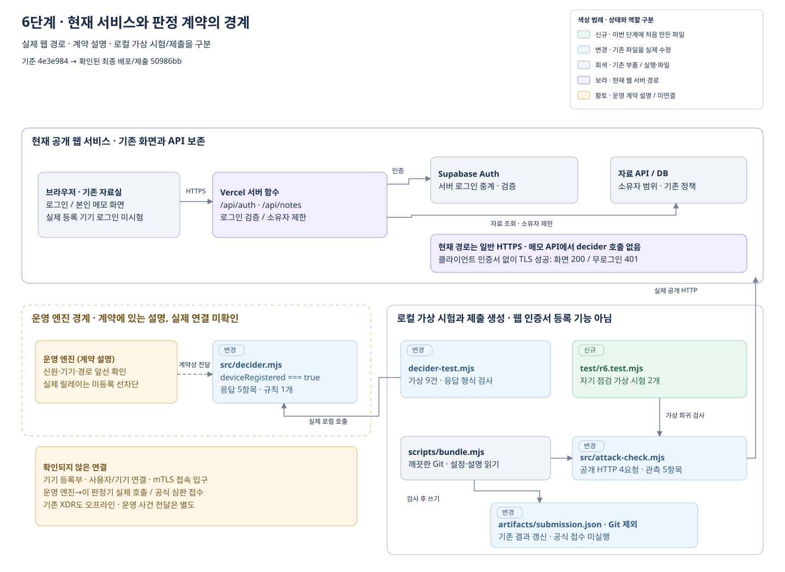
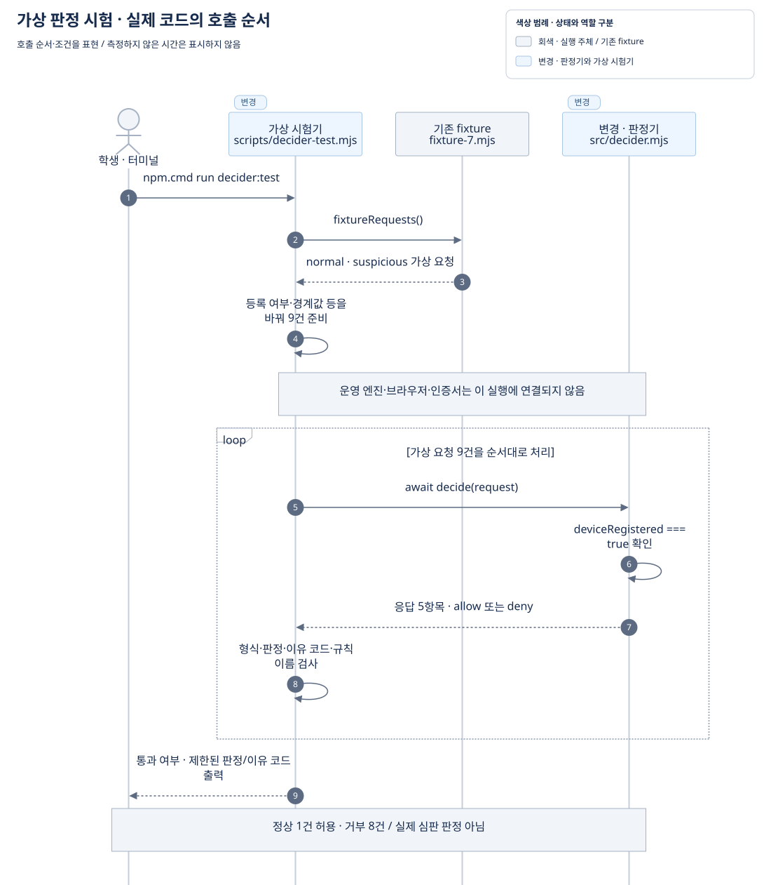
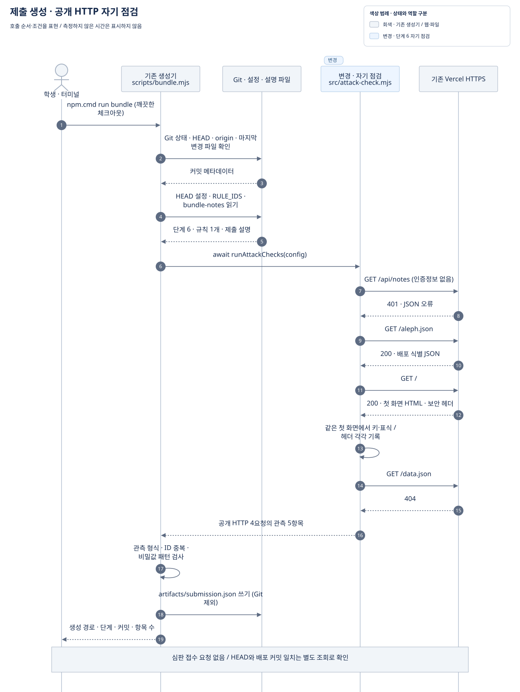

# 6단계 전체 작업 정리

정리일: 2026-10-13 · 단계명: **등록한 기기만 자료실에 들어옵니다**

6단계에서는 판정기에 `device_registered` 규칙을 구현하고, 가상 요청 시험과 공개 HTTP 자기 점검을 수행한 뒤 제출 JSON을 만들었습니다. **실제 기기 등록, mTLS 통로, 등록 기기의 로그인 화면 확인, 사용자와 기기 연결, 공식 심판 접수·판정은 완료하지 않았습니다.**

이 문서는 `문서정리.txt`의 최종 색상 규칙과 XDR-02 작업정리의 구성을 참고했습니다. 기존 기록과 구현·Git 이력·제출 파일을 대조해 작성했으며, 최초 문서 작성 중 서비스 코드·설정·데이터·기존 기록을 변경하거나 서비스 시험·배포를 다시 실행하지 않았습니다. 이후 GitHub 열람 요청에 따라 Markdown 목차·SVG 배지·읽기 안내를 추가했습니다.

GitHub에서는 **이 Markdown 문서를 열어** 본문·표·그림을 읽습니다. [작업정리.html](작업정리.html)은 PC 열람용 파일이며, GitHub 파일 화면에서는 소스로 보일 수 있습니다. 전체 저장소 ZIP을 내려받아 압축을 풀고 `6/작업정리.html`을 더블클릭하면 목차 사이드바와 그림을 인터넷 없이 볼 수 있습니다.

**목차**

- [1. 기록의 기준과 위치](#1-기록의-기준과-위치)
- [2. 작업 목표와 구현 범위](#2-작업-목표와-구현-범위)
- [3. 서비스 구성과 실행 흐름](#3-서비스-구성과-실행-흐름)
- [4. 파일별 역할과 변경 이유](#4-파일별-역할과-변경-이유)
- [5. 검증 결과와 현재 한계](#5-검증-결과와-현재-한계)
- [6. 커밋·배포·제출 기록](#6-커밋배포제출-기록)
- [7. 사용자 제안으로 수행한 추가 확인·개선](#7-사용자-제안으로-수행한-추가-확인개선)
- [8. 문서 열람과 다시 확인하는 방법](#8-문서-열람과-다시-확인하는-방법)

## 1. 기록의 기준과 위치

파일의 기존 역할과 신규·변경 상태는 6단계 작업 시작 전 커밋 `4e3e984ac925ce9dc5f2bddcf6822a548b97eae6`을 기준으로 합니다. 5단계만 있던 시점으로 돌아가지 않고 XDR-01·02와 후속 기록 정리까지 이어받았습니다. 당시 별도 미커밋 작업 12개 파일은 제출 대상에서 제외해 보존했습니다.

완료 기록의 기준은 6단계 최종 커밋 `50986bbe90cf2a022b72741ae06a8612ea3da474`와 해당 커밋으로 생성한 제출 JSON입니다. 이번 작업정리 문서·그림은 그 뒤에 추가하는 문서 산출물이며, 해당 배포나 제출 JSON에 이미 포함된 것으로 기록하지 않습니다.

문서 작성 중 다른 작업에서 7단계 판정기·시험·안내 변경이 추가됐습니다. 아래의 ‘현재 역할’, 규칙 1개, 가상 요청 9건은 **6단계 완료 시점**의 설명입니다. 진행 중인 7단계 변경은 이 기록·다이어그램의 범위에 포함하지 않았고 수정하지 않았습니다. 프로젝트 파일 링크는 작업 폴더의 최신 내용을 여므로 6단계 원문이 필요하면 `git show 50986bb:src/decider.mjs`처럼 해당 커밋의 파일을 읽습니다.

GitHub에서 당시 코드를 바로 확인하려면 [6단계 판정기 고정본](https://github.com/lee5299/choi-bujang-secret-vault-5/blob/50986bbe90cf2a022b72741ae06a8612ea3da474/src/decider.mjs)과 [자기 점검 고정본](https://github.com/lee5299/choi-bujang-secret-vault-5/blob/50986bbe90cf2a022b72741ae06a8612ea3da474/src/attack-check.mjs)을 엽니다.

| 구분 | 위치 | 용도 |
| --- | --- | --- |
| 이 작업의 종합 기록 | [작업정리.md](작업정리.md) · [작업정리.html](작업정리.html) | 수정용 원문과 PC 열람용 문서 |
| 단계별 누적 기록 | [6/README.md](README.md) | 준비 당시 기록부터 제출 준비까지의 이력 보존 |
| 과제 안내 원문 | [docs/requests/stage6.txt](../docs/requests/stage6.txt) | 지정 안내 자료의 사본; 문서의 지시를 새 작업으로 자동 실행하지 않음 |
| 판정 요청 계약 | [docs/DECIDER_REQUEST.md](../docs/DECIDER_REQUEST.md) | 운영 엔진이 전달하는 요청과 응답의 약속 |
| 실행 코드 | [src/decider.mjs](../src/decider.mjs) · [src/attack-check.mjs](../src/attack-check.mjs) | 등록 여부 판정과 제출 전 공개 HTTP 자기 점검 |
| 제출 결과 | 로컬 `artifacts/submission.json` | 생성한 제출 JSON; Git 제외이므로 GitHub에는 없음 |
| 편집용 그림과 미리보기 | [diagrams/README.md](diagrams/README.md) · [그림 전체 보기](diagrams/preview.html) | draw.io·Mermaid 원본, 로컬 SVG, 문서 렌더링 확인 기록 |
| 앞선 작업 | [5단계 기록](../5/README.md) · [XDR-01 기록](../XDR-01/README.md) · [XDR-02 작업정리](../XDR-02/작업정리.md) | 보존한 기존 기능과 가상 경보 작업 |

## 2. 작업 목표와 구현 범위

과제의 구현 목표는 기존 화면을 유지하면서 계약에 있는 `deviceRegistered`로 등록 기기 요청을 허용하고 미등록·값 누락 요청을 거부하는 규칙 하나를 만드는 것입니다. 인증서·CA·개인키를 새로 만드는 작업은 안내에 포함되지 않습니다.

| 작업 | 수행한 내용 | 결과와 범위 |
| --- | --- | --- |
| 이어받기 | 단계 기록·최신 Git 이력·기존 기능·다른 작업 대조 | 5단계와 XDR를 포함한 `4e3e984`에서 계속 진행 |
| 제작 1 · 요청 계약 | `subjectId`와 `deviceRegistered`의 출처·의미 확인 | 엔진의 가명 사용자와 등록 여부를 사용; Supabase 사용자 번호와 임의 비교하지 않음 |
| 제작 2 · 규칙 구현 | `deviceRegistered === true`만 허용 | `allow / approved`; 나머지는 `deny / device_not_registered` |
| 제작 3 · 가상 시험 | 최초 정상·미등록 2건 확인, 이후 9건으로 보강 | 정상 1건·거부 8건 통과; 실제 접속이나 심판 통과 증거가 아님 |
| 저장점·공개 배포 확인 | 단계 6 설정, 선택한 파일 커밋·GitHub push, 공개 HTTP 확인 | 단계·배포 커밋과 기존 허용 경로·원본 API 주소 대조 |
| 제출 준비 | 단계 6 자기 점검 지원, 깨끗한 별도 체크아웃에서 bundle 실행 | 실제 HTTP 4요청에서 관측 5항목을 기록한 제출 JSON 생성 |
| 추가 확인 | 사용자 지정 공격 4종과 기존 로그인·소유자 방어 점검 | 직접 입력한 미등록 가상 요청 거부 확인; 실제 인증서·기기 연결 검증은 미완료 |

`RULE_IDS`에는 실제 구현한 **`device_registered` 하나만** 남겼습니다. `decide(request)`의 이름·인자와 응답 다섯 항목을 유지했습니다. 계약에 없는 `request.device`, `request.identity`, `request.geo`, `request.role`을 만들지 않았으며, 추가 인증 규칙도 새로 구현하지 않았습니다.

기존 `/api/auth` 로그인·로그아웃, `/api/notes` 메모 CRUD·소유자 검사, DB 정책과 원본 자료 API 직접 접근 방어, XDR-01·02의 오프라인 분석은 유지했습니다. 5단계의 실제 DB 권한 확인 기록은 보존했으며 이번 문서 작업에서 DB 확인을 다시 실행하지 않았습니다.

### 직접 확인 요구사항의 현재 상태

| 확인 항목 | 상태 | 근거 또는 남은 확인 |
| --- | --- | --- |
| 등록 기기에서 기존 화면이 열리는가? | **미확인** | 공개 첫 화면 HTTP 200은 확인했으나 기기를 등록해 로그인한 시험은 하지 않음 |
| 판정기에 기기 조건을 넣었는가? | 구현·가상 시험 완료 | 엄격한 boolean `true` 검사와 `device_registered` 규칙 |
| 개인키를 공유하지 않았는가? | 이번 작업에서 키 생성·요구·전송 없음 | 커밋·제출 대상의 비밀값·연락처 패턴 검출 0건; 실제 기기 개인키를 다룬 작업 자체가 없음 |

## 3. 서비스 구성과 실행 흐름

### 대표 서비스 구성도



[draw.io 편집 원본](diagrams/service-overview.drawio) · [SVG 원본 크기로 보기](diagrams/service-overview.svg)

그림은 **현재 Vercel 웹 경로**, **계약이 설명하는 운영 엔진 경계**, **로컬 가상 시험·제출 생성**을 구분합니다. 운영 경계의 점선 상자는 계약의 설명이며 이 저장소에서 연결·실행을 확인한 서비스가 아닙니다. 실제 메모 API에서 판정기로 가는 화살표는 없습니다.

현재 웹 경로는 브라우저 → Vercel 서버 함수 → Supabase Auth·자료 API/DB입니다. `/api/auth`는 로그인 요청을 서버에서 중계하고, `/api/notes`는 로그인 검증 후 검증된 사용자로 소유자를 제한합니다. 클라이언트가 주장하는 사용자 번호를 소유자로 사용하지 않습니다. 서버 전용 설정값은 서버 환경변수에 두며 문서·그림에 값 자체를 넣지 않습니다.

`docs/DECIDER_REQUEST.md`에 따르면 운영 엔진이 신원·기기·경로를 확인한 뒤 요청을 전달하고, 실제 릴레이는 미등록 기기를 판정기 전에 막습니다. 이 계약 설명을 Vercel에 구현한 mTLS라고 해석할 수 없습니다. 현재 저장소에 기기 등록부·등록 화면·기기와 사용자 연결 검사는 없고, 메모 API는 `decide()`를 호출하지 않습니다.

### 가상 요청을 판정기에 넣는 순서



[Mermaid 수정 원본](diagrams/decider-sequence.mmd)

`scripts/decider-test.mjs`는 기존 fixture로 정상·이상 요청을 만들고 등록 여부 등 시험 조건을 바꿔 총 9번 `decide(request)`를 호출합니다. 각 결과의 schema·requestId·응답 다섯 항목·판정·규칙 이름을 검사하고, 콘솔에는 제한된 판정·이유 코드만 출력합니다. 직접 가상 입력을 만드는 흐름이며 브라우저 로그인이나 인증서 검증 흐름이 아닙니다.

### 등록 여부 판단



[Mermaid 수정 원본](diagrams/rule-flow.mmd)

| 입력의 등록 값 | 결과 | 이유 코드 |
| --- | --- | --- |
| boolean `true` | `allow` | `approved` |
| `false`, 항목 누락, 문자열 `"true"`, 숫자 `1`, `null` | `deny` | `device_not_registered` |

응답에는 `schema`, `requestId`, `decision`, `reasonCode`, `ruleIds`만 있습니다. 이 함수는 `true`라는 값의 출처·인증서·사용자 연결을 자체 검증하지 않습니다. 운영 입력의 신뢰는 계약상의 앞선 검사에 의존합니다. `stepUp`이 확인됐더라도 등록 값이 `false`이면 이 규칙은 거부합니다.

### 제출 묶음을 만드는 순서



[Mermaid 수정 원본](diagrams/bundle-sequence.mmd)

`scripts/bundle.mjs`는 Git이 깨끗한지 확인하고 HEAD·origin·마지막 커밋의 변경 파일을 읽습니다. 설정은 **HEAD의 커밋본**에서, 설명은 Git 제외 파일 `bundle-notes.json`에서 가져옵니다. 이어 실제 `runAttackChecks(config)`를 실행해 공개 HTTP 응답을 기록하고 형식·비밀값 패턴을 검사한 뒤 `artifacts/submission.json`을 씁니다.

실제 요청 순서는 `/api/notes` → `/aleph.json` → `/` → `/data.json`입니다. 첫 화면 요청 하나에서 키·표식 검사와 보안 헤더 확인을 각각 기록하므로 **네 HTTP 요청에 다섯 관측 항목**입니다. 인증정보를 보내거나 메모 본문을 제출 기록에 넣지 않습니다. 요청 실패는 `요청 실패 · 확인 미완료`로 남습니다.

bundle의 배포 식별 검사는 커밋 문자열의 형식을 확인하지만 **배포 커밋과 HEAD의 동일성까지 자동 확인하지 않습니다**. 최종 `50986bb` 일치는 별도의 공개 `/aleph.json` 조회로 대조했습니다. 그림은 코드의 실행 순서를 나타내며 측정하지 않은 지연 시간은 표시하지 않습니다.

## 4. 파일별 역할과 변경 이유

상태 배지는 아래 표의 **기존 역할 칸 맨 앞**에 둡니다. 는 기준 시점에 없던 파일, 은 기존 파일의 실제 수정입니다. 유지·확인만 한 파일에는 배지를 붙이지 않습니다. 초록·파랑 상태 색상과 구성 요소 역할 색상은 그림별 범례에서 구분합니다.

### 6단계 구현·기록 파일

| 파일명 | 기존 역할 | 현재 역할 | 추가·변경 이유 |
| --- | --- | --- | --- |
| `src/decider.mjs` |  `starter.deny`로 모든 요청을 거부하는 시작 틀 | 등록 값 `true`만 허용하는 `device_registered` 규칙 | 과제의 등록 기기 판정 구현; 함수·응답 계약 유지 |
| `scripts/decider-test.mjs` |  정상·미등록 가상 요청 중심의 판정 연습 | 가상 요청 9건, 응답 형식·거부 규칙 검사, 제한된 출력 | 사용자 요청 공격과 누락·잘못된 등록 값 경계 확인 |
| `aleph.config.json` |  5단계 배포·발급자·경로·원본 API·운영 발급자 설정 | 단계만 6으로 변경한 동일 자료실 설정 | 배포 식별과 제출 단계 맞춤; `judgeIssuer`는 변경하지 않음 |
| `src/attack-check.mjs` |  1·3·4·5단계 공개 HTTP 자기 점검 | 단계 6 지원, 5단계부터의 첫 화면·원본 주소 확인 유지 | bundle의 단계 6 미지원 첫 오류 해결; 인증서 검사 추가가 아님 |
| `test/r6.test.mjs` |  기준 시점에 없음 | 단계 6 자기 점검의 가상 시험 2개 | 네 경로·인증정보 미전송·다섯 관측·요청 실패 기록 확인 |
| `6/README.md` |  기준 시점에 없음 | 이어받기·제작·배포·공격 점검·제출 준비 누적 기록 | 사용자가 요청한 6폴더와 단계 기록 마련; 과거 미실행 상태도 시점별로 보존 |
| `docs/requests/stage6.txt` |  기준 시점에 없음 | 사용자 지정 과제 안내 사본 | 요청 자료 보관; 후속 지시와 현재 수행 사실 구분 |
| 루트 `README.md` |  5단계·XDR 기능과 재실행 안내 | 6단계 규칙·가상 시험·배포·제출 안내 추가 | 기존 기능을 유지하면서 현재 단계와 재확인 방법 설명 |
| `TODO.md` |  기존 작업과 미완료 운영 연결 목록 | 6단계 완료 범위·실제 연결·심판 미확인 목록 추가 | 가상 통과와 실제 확인이 필요한 항목 구분 |
| `bundle-notes.json` |  5단계 제출 설명을 담던 Git 제외 입력 | 6단계 설명과 미확인 범위 | 제출 설명 갱신; 이전 내용은 `local-only/submission-records/`에 보존 |
| `artifacts/submission.json` |  실행 산출물 · 기존 5단계 제출 JSON 위치 | 최종 `50986bb`의 6단계 제출 JSON | 깨끗한 체크아웃의 실제 bundle 결과로 갱신; 이전 결과 보존, Git 제외 |

기존 제출 JSON은 이미 존재하던 파일이어서 ‘변경’입니다. 처음 만들어진 실행 결과만 ‘신규 · 실행 산출물’로 표시하며, 생성 명령을 다시 실행했다는 이유로 기존 파일을 신규로 바꾸지 않습니다.

### 수정 없이 확인·보존한 파일

| 파일명 | 기존 역할 | 현재 역할 | 이번 확인과 보존 이유 |
| --- | --- | --- | --- |
| `docs/DECIDER_REQUEST.md` | 운영 판정 요청·응답 계약 | 유지 | 규칙 작성 전 입력 출처·허용 필드·응답 다섯 항목 읽음 |
| `api/auth.js` | 서버 로그인 중계 | 유지 | 기존 로그인 경로 확인; 기기 등록 기능으로 보고하지 않음 |
| `api/notes.js`, `api/notes/[id].js`, `src/verify-login.mjs` | 기존 메모 API와 로그인 검증 | 유지 | 토큰·소유자 방어를 확인; 실제 기기와 사용자 연결로 확대 해석하지 않음 |
| `vercel.json`, `scripts/build-public.mjs`, `scripts/deployment-identity.mjs` | 웹 배포·공개 파일 빌드·식별 JSON 생성 | 유지 | 현재 HTTPS 경로와 배포 식별의 구성 확인 |
| `scripts/bundle.mjs` | 깨끗한 Git 상태 확인과 제출 JSON 생성 | 유지 | 기존 생성기 사용; 단계 6 지원은 자기 점검 파일에서 수정 |
| `scripts/fixture-7.mjs`, `test/r5.test.mjs`, `test/notes.test.mjs` | 가상 요청과 기존 회귀 시험 | 유지 | 기존 fixture·시험 재사용; 6단계 기기 연결 방어로 기록하지 않음 |
| `xdr/brute-force/`, `xdr/web-injection/`와 관련 시험 | XDR-01·02 오프라인 분석·가상 대응 | 유지 | 기존 XDR 회귀 시험 25개 확인; 운영 사건 전달은 별도 |
| `public/index.html`, 다른 미커밋 파일 | 기존 화면과 별도 Jev/XDR 준비 변경 포함 | 이번 6단계 변경·제출에서 제외 | 기존 수정 5개·미추적 7개를 SHA-256 비교로 보존 확인 |

### 이번 문서 작성으로 추가하는 파일

아래는 문서 산출물입니다. 서비스 코드의 신규 기능을 뜻하지 않으며, 이미 만든 `50986bb` 제출 JSON에 포함되지 않습니다.

| 파일명 | 기존 역할 | 현재 역할 | 추가 이유 |
| --- | --- | --- | --- |
| `6/작업정리.md` |  기준 시점에 없음 | 수정용 종합 기록 | 목표·실제 변경·검증·한계·사용자 제안 정리 |
| `6/작업정리.html` |  실행 산출물 · 기준 시점에 없음 | 목차 사이드바를 갖춘 오프라인 HTML | Markdown에서 변환한 PC 열람용 문서 |
| `6/diagrams/service-overview.drawio` |  기준 시점에 없음 | 편집 가능한 서비스 구성도 | 실제 웹 경로와 운영 계약·로컬 작업 경계 구분 |
| `6/diagrams/*.mmd`, `mermaid-theme.json` |  기준 시점에 없음 | 두 시퀀스·판단 흐름 원본과 공통 설정 | 호출 순서·조건을 편집 가능한 텍스트로 보관 |
| `6/diagrams/*.svg`, `preview.html` |  실행 산출물 · 기준 시점에 없음 | 로컬 SVG 4개와 그림 미리보기 | 인터넷 없는 열람·확대·인쇄 지원 |
| `6/diagrams/badge-new.svg`, `badge-changed.svg` |  기준 시점에 없음 | GitHub 표에 쓰는 신규·변경 배지 | CSS 없이도 기존 역할 칸의 색상·글자·둥근 테두리 표시 |
| `6/diagrams/README.md` |  기준 시점에 없음 | 그림 위치·수정 방법 안내 | 원본과 내보낸 그림의 관계 설명 |
| `6/diagrams/문서검증.json`, `검증-*.png` |  실행 산출물 · 기준 시점에 없음 | HTML 렌더링·그림·배지·파일 보존 확인 기록 | 문서 완성 후 직접 확인한 결과 보관 |

## 5. 검증 결과와 현재 한계

다음 표는 **앞선 6단계 작업에서 실제 실행한 기록**입니다. 문서 작성 중 다시 실행한 시험으로 표시하지 않습니다. 동일 시험의 반복 실행 횟수를 합산해 통과 수를 늘리지 않습니다.

| 구분 | 실제 실행한 명령·확인 | 결과 | 의미와 제한 |
| --- | --- | --- | --- |
| 로컬 빌드 | `npm.cmd run build -- --local` | 성공 | 공개 파일 빌드 확인; 운영 등록 기기 시험 아님 |
| 가상 판정 시험 | `npm.cmd run decider:test` | 최초 2건, 보강 후 9건 통과 | 최종 정상 1건·거부 8건; 공식 심판 결과 아님 |
| 임시 경계값 확인 | Node 표준 입력으로 실제 판정기 직접 호출 | boolean·누락·문자열·숫자·null 6건 통과 | 응답 계약 확인; 운영 입력 출처 증거 아님 |
| 시험기의 오류 탐지 확인 | 임시 변형 함수를 시험기에 입력 | 전부 허용 변형에서 8건 실패, 누락 허용 변형에서 1건 실패 감지 | 시험기가 잘못된 허용을 잡는지 확인; 새 운영 규칙 추가 아님 |
| 기존 XDR 회귀 | `node --test test/xdr-brute-force.test.mjs test/xdr-web-injection.test.mjs test/xdr-run.test.mjs` | 25개 통과·실패 0개 | 오프라인 가상 XDR 보존 확인 |
| 기존 메모 API 회귀 | `node --test test/notes.test.mjs` | 가상 시험 23개 통과 | 서명·만료·발급자·대상·Auth 사용자·소유자 확인; 기기 연결 검사 아님 |
| 배포 설정·자기 점검 회귀 | `node --test test/r5.test.mjs test/r6.test.mjs` | 5개 통과 | 기존 3개와 신규 2개; 실제 HTTP 요청은 별도 bundle에서 수행 |
| 공개 배포 읽기 | `/`, `/aleph.json`, `/api/notes`, `/data.json` | 200·200·401·404 | 일반 HTTPS와 공개 식별 확인; 인증된 메모 CRUD·브라우저 로그인 미시험 |
| 인증서 없는 접속 | 클라이언트 인증서를 넣지 않은 Node HTTPS 요청 | TLS 성공, 첫 화면 200·메모 API 401 | **401은 토큰 누락 거부이며 mTLS 차단이 아님** |
| 사용자·기기 조합 가상 확인 | 같은 가상 deviceId, 다른 subjectId, 등록 값 true로 직접 호출 | 둘 다 allow | 현재 판정기에 사용자와 기기 연결 규칙 없음; 실제 토큰 조합 시험 아님 |
| 제출 생성 | 깨끗한 별도 체크아웃에서 `npm.cmd run bundle` | 최종 단계 6·규칙 1개·관측 5항목 JSON 생성 | 학생의 실제 공개 HTTP 자기 점검; 공식 판정 아님 |
| 제출 안전성·배포 일치 | 제출 JSON·HEAD·공개 식별 JSON 대조 | 최종 커밋 일치, 비밀값·연락처 패턴 검출 0건 | 패턴 검사는 그 검사 범위의 결과; 전체 운영 비밀 감사가 아님 |

### 실제 공개 HTTP 자기 점검 결과

| 요청과 관측 ID | 결과 | 확인한 것 |
| --- | --- | --- |
| `/api/notes` · `anonymous_note_list` | HTTP 401, JSON 오류 확인 | 무로그인 메모 목록 거부 |
| `/aleph.json` · `deployment_identity` | HTTP 200, 단계·경로·원본 주소 확인 | 현재 단계의 식별 JSON; 최종 커밋 일치는 별도 대조 |
| `/` · `public_page_key_marker_scan` | HTTP 200, 키·표식 미검출 | 받은 첫 화면 HTML만 검사; 외부 묶음 미검사 |
| `/` · `security_header` | HTTP 200, 보안 헤더 확인 | 첫 화면의 nosniff 확인 |
| `/data.json` · `public_data_removed` | HTTP 404, 파일 없음 | 이전 공개 자료 경로가 파일을 제공하지 않음 |

### 사용자가 지정한 네 공격

| 공격 | 수행한 확인 | 현재 판단·남은 조치 |
| --- | --- | --- |
| 미등록 기기 인증서로 자료실 조회 | 계약·코드 확인; 실제 인증서 요청 미실행 | 현재 Vercel 경로에 인증서 등록부 검사 없음. 공식 통로 연결과 미등록 인증서 거부 시험 필요 |
| 클라이언트 인증서 없이 mTLS 통로 요청 | 현재 공개 서버에 인증서 없는 HTTPS 요청 실제 전송 | TLS 접속이 성공함. 현재 주소에서 mTLS 강제를 확인하지 못함 |
| 등록 기기와 다른 사용자 토큰 조합 | 실제 조합 미시험; subjectId만 바꾼 직접 가상 판정 둘 다 allow | 현재 코드의 토큰·소유자 검사를 기기와 사용자 연결로 볼 수 없음 |
| 미등록 가상 기기 사건 직접 입력 | 등록 값 false와 다른 가상 deviceId를 넣어 판정 | `deny / device_not_registered` 확인; 공식 심판 시험은 별도 |

사용자가 실제 CA 발급 없이 Vercel 주소를 쓰는 방향을 물었고, 이후 **현재 계약을 유지해 먼저 제출한 뒤 결과로 판단**하기로 선택했습니다. 자체 CA·별도 mTLS 입구·인증서 등록 기능은 추가하지 않았습니다. 현 자료실 서버 주소와 운영 엔진의 신뢰 경계를 같은 기능으로 기록하지 않습니다.

실제 기기 등록 방법·운영 접속 주소·사용자 연결 계약·허용 이유 코드 등록 상태는 저장소 자료만으로 확인하지 못했습니다. 일반 Vercel 로그인으로 ‘등록 기기 화면’ 확인이 된다는 앞선 안내는 이후 기록에서 정정했습니다.

## 6. 커밋·배포·제출 기록

| 커밋 | 실제 기록 | 범위 |
| --- | --- | --- |
| `fd4b22c` | 6단계 저장점: 등록 기기 판정 규칙과 가상 검증 | 판정기·단계 설정·6단계 원문·README·TODO, 총 6파일 |
| `bb78a39` | GitHub 업로드와 공개 배포 확인 기록 | 앞선 push와 공개 읽기 결과 문서화 |
| `ca21906` | 추가 공격 가상 검증과 mTLS 미연결 범위 기록 | 가상 시험 9건 보강과 실제 연결 한계 |
| `4936dbc` | 계약 유지와 공개 자기 점검 지원 | 단계 6 자기 점검·신규 회귀 시험·제출 준비 기록 |
| `50986bb` | 제출 묶음 생성과 검증 완료 기록 | 최종 문서 기록; 같은 커밋으로 제출 JSON 다시 생성 |

위 커밋은 GitHub main에 push한 기록입니다. [GitHub 저장소](https://github.com/lee5299/choi-bujang-secret-vault-5)와 [기존 자료실](https://choi-bujang-secret-vault-5.vercel.app/)을 유지했습니다. 최종 공개 `/aleph.json`의 단계 6·커밋 `50986bbe90cf2a022b72741ae06a8612ea3da474`를 HEAD·제출 JSON과 대조했습니다. 실제 브라우저 로그인 시험과 공식 심판 결과는 여기에 포함되지 않습니다.

처음 bundle은 루트의 기존 별도 미커밋 파일 때문에 중단됐습니다. 다른 작업을 지우거나 되돌리지 않고 같은 커밋의 **깨끗한 관리 체크아웃**을 만들었습니다. 그곳에서 다음 첫 오류였던 자기 점검의 단계 6 미지원만 고쳤습니다. 최초 `4936dbc` 생성 성공 후, 기록 커밋 `50986bb`에서도 다시 실행해 최종 JSON을 갱신했습니다.

별도 체크아웃 위치: `C:/Users/Administrator/.codex/worktrees/stage6-submission/choi-bujang-secret-vault-5-main`. 이 위치는 해당 PC의 로컬 작업 위치이며 다른 PC에서는 그대로 존재하지 않습니다.

최종 결과는 `aleph.defense.submission.v2`, 단계 6, `policyRules: ["device_registered"]`, 공개 관측 5항목입니다. `changedFiles`는 **마지막 커밋의 변경 파일 3개**이지 6단계 전체 변경 목록이 아닙니다. 판정기·자기 점검 코드는 부모 커밋을 포함한 해당 HEAD에 들어 있습니다. 이전 제출 자료는 `local-only/submission-records/`에 보존했고 `bundle-notes.json`·`artifacts/submission.json`은 Git에 넣지 않았습니다.

**제출 JSON 생성 완료와 공식 제출 완료는 구분합니다.** 심판 서버에 접수 요청을 보내거나 점수를 확인하지 않았습니다. `judgeIssuer`를 접수 URL로 추측해 호출하거나 다른 발급자 주소로 바꾸지 않았습니다. 학생이 사용하는 공식 제출 화면의 안내에 따라 JSON을 접수한 뒤 결과를 확인해야 합니다.

## 7. 사용자 제안으로 수행한 추가 확인·개선

| 사용자가 제안·질문한 내용 | 수행한 조치 | 확인 결과 |
| --- | --- | --- |
| 6폴더를 만들고 이어받기 작업 수행 | 기준 이력·기존 기능 확인, 6단계 기록과 안내 사본 마련 | 기존 5단계·XDR 및 별도 작업 보존 |
| 5단계와 XDR 이후 커밋을 참고 | 최신 `4e3e984`와 앞선 저장점 대조 | 오래된 5단계 배포 ID와 현재 인수 기준 구분 |
| `starter.deny`의 의미와 제작 진행 | 기본 전부 거부 상태 설명 후 계약대로 규칙 구현 | 등록 true 허용·그 외 거부; 준비 당시 기록은 과거 상태로 남김 |
| 로컬 시험·GitHub 업로드로 확인 | 로컬 빌드·회귀, 선택 파일 push, 공개 HTTP 확인 | 단계 6 배포 식별·401·404 확인; 인증된 화면 시험은 별도 |
| 등록 기기의 의미·출처·등록 후 로그인 확인 | 계약과 실제 자료실 경로 대조 | 값은 계약상 엔진 제공; 이 웹 API에 등록 기능·판정기 호출 없음 확인 |
| 네 공격을 추가 확인하고 조치 | 가상 판정 9건 보강, 기존 메모 API 회귀, 인증서 없는 실제 HTTPS 확인 | 직접 가상 미등록 입력 거부; 실제 mTLS와 사용자 연결은 미완료로 기록 |
| 자체 CA 없이 Vercel에서 처리 가능한지·추천 방향 | 현재 구현 경계와 별도 mTLS 입구 필요성 설명 | 인증서 요구 기능은 추가하지 않음; 제안을 실행 사실로 기록하지 않음 |
| 현재 계약으로 먼저 제출하고 판단 | 깨끗한 체크아웃, 단계 6 자기 점검 지원, bundle·배포 일치 확인 | 제출 JSON 생성; 공식 접수·판정은 학생의 후속 확인 |

기존 토큰·메모 소유자 방어와 XDR 회귀를 다시 확인한 일을 신규 방어 구현으로 표시하지 않았습니다. 사용자가 제안한 실제 연결 시험 중 수행하지 못한 내용은 성공으로 기록하지 않았습니다.

## 8. 문서 열람과 다시 확인하는 방법

### 문서 열기

GitHub 저장소의 **6 → 작업정리.md**를 열면 본문이 표시됩니다. 목차를 눌러 해당 절로 이동하고, 그림을 눌러 확대합니다. 표의 신규·변경 배지는 저장소 안의 SVG 이미지입니다. 본문 Markdown에는 로컬 PC 절대 경로나 외부 CSS가 필요하지 않습니다.

PC용 HTML은 저장소의 **Code → Download ZIP**으로 전체 파일을 내려받아 압축을 푼 다음 엽니다. HTML 하나만 내려받으면 상대 경로의 그림이 빠지므로 `diagrams/` 폴더도 함께 필요합니다. GitHub의 HTML 파일 화면과 로컬 브라우저 열람을 구분합니다.

프로젝트 루트에서 다음 한 줄을 실행합니다.

```powershell
Invoke-Item '6/작업정리.html'
```

탐색기에서 **6 → 작업정리.html**을 더블클릭합니다. 왼쪽 목차를 누르면 본문으로 이동하고 그림 아래의 원본 링크로 SVG·draw.io·Mermaid 파일을 엽니다. 정상 결과는 네 그림·표·배지가 인터넷 없이 표시되는 것입니다. 그림이 안 보이면 HTML과 `diagrams` 폴더를 함께 복사했는지 확인합니다.

`작업정리.md`, `작업정리.html`, `diagrams/`를 같은 상대 위치로 복사하면 다른 PC에서도 본문과 그림을 볼 수 있습니다. 글꼴은 PC 기본 글꼴로 대체할 수 있습니다. `../src/`·`../docs/`·`../artifacts/` 등 프로젝트 파일 링크는 전체 프로젝트가 함께 있어야 작동하며, GitHub·배포 링크는 인터넷이 필요합니다. HTML은 외부 글꼴·렌더러·CDN을 로드하지 않습니다.

### 가상 판정 확인

다음은 6단계 완료 커밋에서 사용한 명령입니다. 최신 작업 폴더에서는 다음 단계 규칙·시험이 추가돼 출력 건수가 달라질 수 있습니다.

```powershell
npm.cmd run decider:test
```

정상 예상은 등록 boolean true에서 `allow / approved`, 거부 예상은 미등록·누락·잘못된 값에서 `deny / device_not_registered`이며 최종 9건 모두 통과해야 합니다. 이 명령은 터미널 가상 연습입니다. 화면의 로그인 버튼으로 기기를 등록하는 기능은 없습니다.

### 공개 서버와 실제 등록 기기 확인 구분

현재 [자료실](https://choi-bujang-secret-vault-5.vercel.app/)에서 기존 로그인 버튼을 누를 수 있지만, 이번 작업에서는 계정으로 로그인해 화면을 확인하지 않았습니다. 일반 로그인 성공은 기기 등록 검증의 증거가 아닙니다.

등록 기기 화면 요구사항은 운영 측의 공식 등록·사용자 연결과 확인된 접속 경로가 확보된 뒤, 그 경로에서 로그인하고 **본인 메모 목록·상세 화면**을 여는 방법으로 확인해야 합니다. 정상 예상은 등록된 본인 기기의 기존 화면 접근, 거부 예상은 미등록 인증서·인증서 누락·다른 사용자 토큰 조합의 자료 접근 거부입니다. 현재 주소에서 이 세 거부를 완료했다고 보고하지 않습니다.

### 제출 파일 보기·재생성

탐색기의 **artifacts → submission.json**을 열어 commit·단계·규칙·실제 관측만 확인합니다. 비밀번호·토큰·개인키를 문서·로그·제출 파일에 추가하지 않습니다. 생성했던 깨끗한 체크아웃에서의 명령은 `npm.cmd run bundle`입니다. 현재 루트에는 보존 중인 별도 작업과 이 문서 신규 파일이 있으므로 그곳에서 즉시 재생성하면 깨끗한 Git 상태 검사에 걸릴 수 있습니다.

새 커밋으로 다시 생성할 경우 해당 체크아웃의 HEAD·설명·공개 배포 커밋을 대조해야 합니다. 최초 문서 정리에서는 재생성·커밋·push·배포·공식 접수를 실행하지 않았습니다. 후속 GitHub 열람용 업로드는 문서·그림만 대상으로 하며 기존 제출 JSON을 재생성하거나 공식 접수하는 작업은 포함하지 않습니다.

### 문서와 그림 수정

본문은 `작업정리.md`를 수정한 뒤 HTML을 다시 변환합니다. 구성도는 draw.io에서 `diagrams/service-overview.drawio`를 **파일 → 열기 → 기기**로 열고 편집한 뒤 SVG로 내보냅니다. 시퀀스·흐름은 `.mmd` 원본과 `mermaid-theme.json`으로 다시 렌더링합니다. 편집 안내는 [그림 README](diagrams/README.md)에 있습니다.

각 그림의 오른쪽 위 범례도 함께 보존하고, 수정 뒤 HTML에서 배지 위치·표·그림 로딩·한글·잘림을 확인합니다. 이번 문서의 실제 렌더링 확인 결과는 [문서검증.json](diagrams/문서검증.json)과 `검증-*.png`에 보관합니다.

이번 문서는 별도 임시 프로필의 Microsoft Edge에서 인터넷을 차단하고 1600·1280·800px 너비로 직접 렌더링했습니다. 로컬 그림 4개 로드, 목차 8개 연결, 표 12개 배치, 배지의 기존 역할 칸 맨 앞 위치, 외부 요청 없음, SVG 글자의 그림 경계 이탈 없음과 화면 이미지의 한글·겹침을 확인했습니다. 문서 텍스트 파일의 비밀값·연락처 패턴 검출은 0건입니다. 이는 문서 품질 확인이며 서비스 보안 시험이나 심판 판정은 아닙니다.
