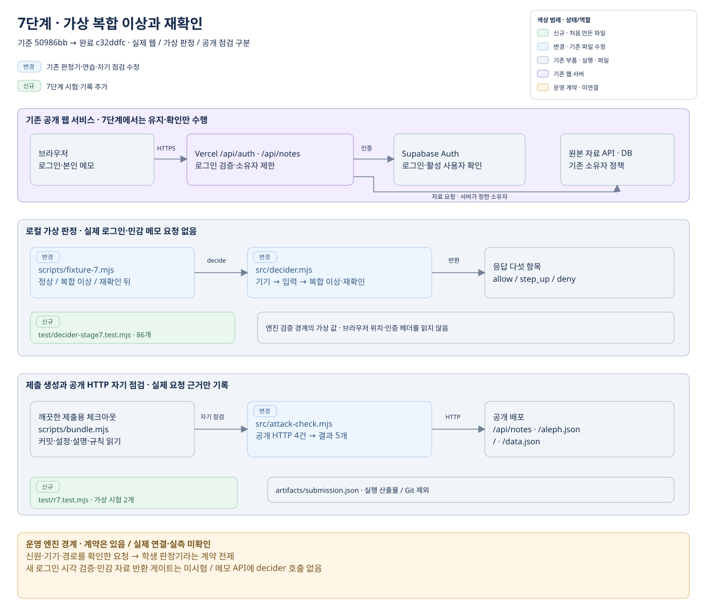
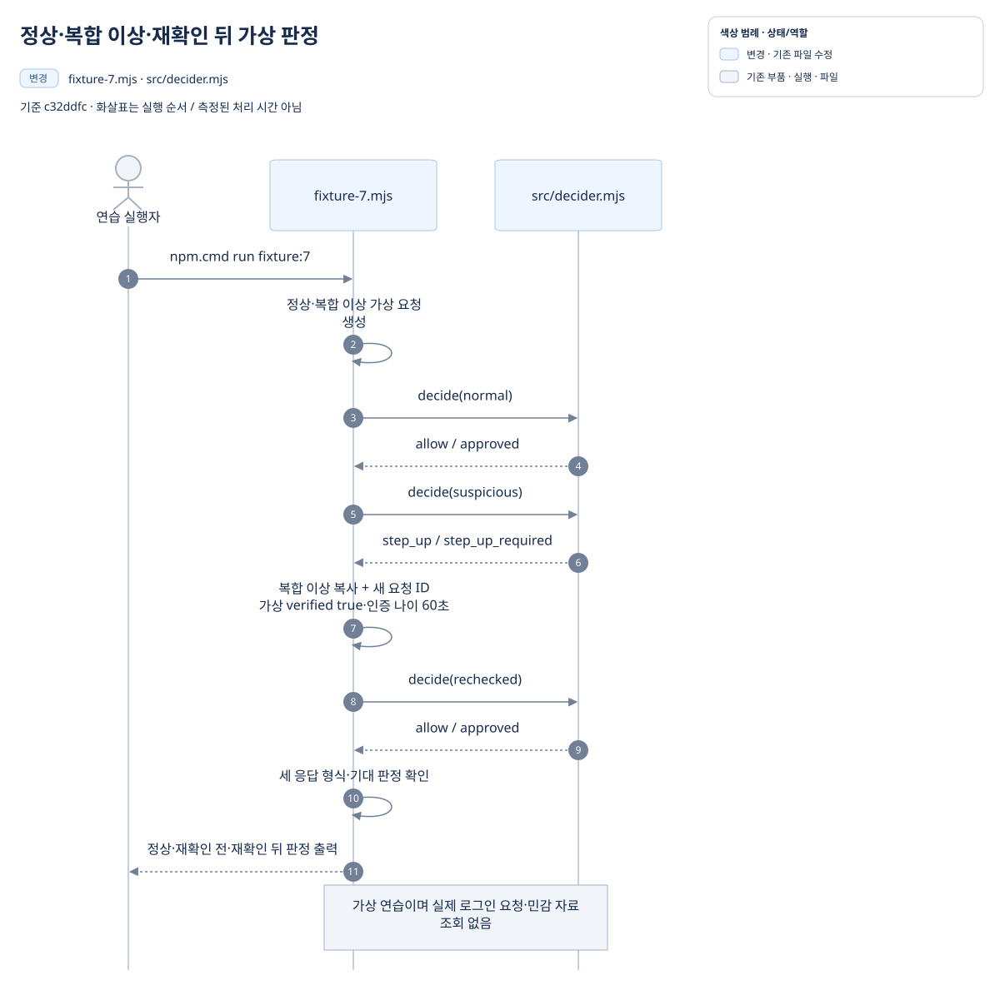
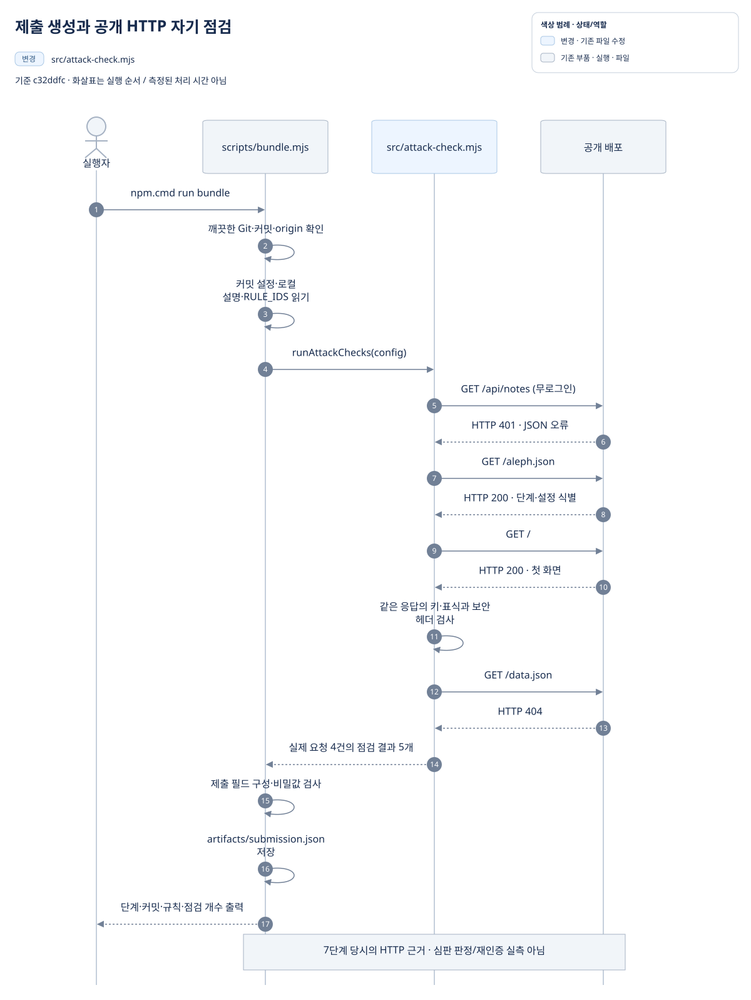

# 7단계 전체 작업 정리

정리일: 2026-10-13 · 단계명: **평소와 다른 접속은 다시 확인합니다**

7단계에서는 등록 기기 규칙 위에 가상 접속 신호 검사와 복합 이상 추가 확인을 더했습니다. 정상 사건은 `allow`, 정해진 복합 이상은 재확인 전 `step_up`, 엔진이 전달한 유효한 재확인 완료 값이 있으면 `allow`입니다. 미등록 기기는 계속 `deny`입니다.

이 문서는 사용자 요청에 따라 `문서정리.txt`의 최종 형식·색상 규칙과 XDR-02 작업정리의 구성을 참고해 작성했습니다. **프로그램·설정·데이터는 변경하지 않았고 서비스 시험·배포·bundle·심판 접수를 다시 실행하지 않았습니다.** 문서·그림의 렌더링 검증만 별도로 수행합니다.

GitHub에서는 **이 Markdown 문서**를 읽습니다. [작업정리.html](작업정리.html)은 PC에서 여는 전체 문서입니다. GitHub에서는 HTML이 소스로 보일 수 있으므로 저장소 ZIP을 내려받아 압축을 풀고 `7/작업정리.html`을 더블클릭합니다. 본문과 그림은 인터넷 없이 열립니다.

**목차**

- [1. 기록의 기준과 위치](#section-1)
- [2. 작업 목표와 구현 범위](#section-2)
- [3. 서비스 구성과 실행 흐름](#section-3)
- [4. 최종 판단 기준과 경계](#section-4)
- [5. 파일별 역할과 변경 이유](#section-5)
- [6. 검증 결과와 현재 한계](#section-6)
- [7. 커밋·배포·제출 기록](#section-7)
- [8. 사용자 제안으로 수행한 추가 확인·개선](#section-8)
- [9. 문서 열람과 재현 방법](#section-9)

<a id="section-1"></a>
## 1. 기록의 기준과 위치

파일의 기존 역할·신규·변경 상태는 7단계 제작 전 커밋 `50986bb`를 기준으로 합니다. 완료 구현은 커밋 `c32ddfc780f3c831b7829163cde9a3225df07557`로 고정했습니다. 이 구간에 함께 올라온 6단계 문서 커밋 `4d1151a`는 다른 작업이므로 7단계 신규 파일 목록에 넣지 않습니다.

문서 작성 당시 작업 폴더에는 8단계 제작 변경도 있습니다. 아래의 ‘현재 역할’은 **7단계 완료 시점**의 역할입니다. 8단계 변경과 기존 별도 미커밋 작업은 수정하거나 문서 커밋에 포함하지 않습니다. 이전 단계·7단계 누적 기록도 보존합니다.

[7단계 판정기 고정본](https://github.com/lee5299/choi-bujang-secret-vault-5/blob/c32ddfc780f3c831b7829163cde9a3225df07557/src/decider.mjs) · [7단계 자기 점검 고정본](https://github.com/lee5299/choi-bujang-secret-vault-5/blob/c32ddfc780f3c831b7829163cde9a3225df07557/src/attack-check.mjs) · [7단계 가상 사건 고정본](https://github.com/lee5299/choi-bujang-secret-vault-5/blob/c32ddfc780f3c831b7829163cde9a3225df07557/scripts/fixture-7.mjs)

| 구분 | 위치 | 용도 |
| --- | --- | --- |
| 전체 작업 정리 | [작업정리.md](작업정리.md) · [작업정리.html](작업정리.html) | GitHub 본문·수정 원본과 PC 열람 문서 |
| 단계 누적 기록 | [7/README.md](README.md) | 준비·제작·보완·제출의 당시 상태 보존 |
| 요청 자료 | [docs/requests/stage7.txt](../docs/requests/stage7.txt) | 사용자가 지정한 과제 안내 원문 |
| 요청·응답 계약 | [docs/DECIDER_REQUEST.md](../docs/DECIDER_REQUEST.md) | 엔진 요청 필드와 응답 다섯 항목 |
| 실행 파일 | [src/decider.mjs](../src/decider.mjs) · [src/attack-check.mjs](../src/attack-check.mjs) | 판정과 제출 전 공개 HTTP 자기 점검 |
| 원본 그림 | [diagrams/README.md](diagrams/README.md) · [그림 미리보기](diagrams/preview.html) | draw.io·Mermaid 원본과 로컬 SVG |
| 로컬 제출 결과 | `artifacts/submission.json`, `artifacts/stage7-preflight.json` | Git 제외 산출물; GitHub에는 올리지 않음 |

상대 경로로 연결한 프로젝트 파일은 열람 시점의 최신 내용을 엽니다. 7단계 코드를 고정해서 볼 때는 위 커밋 링크를 사용합니다. 요청 자료의 제작 문구는 **과거 작업의 요구사항**으로 읽었으며 이번 문서 작성에서 다시 실행하지 않았습니다.

## 2. 작업 목표와 구현 범위

### 과제 요구로 수행한 내용

| 구분 | 목표 | 수행 결과 |
| --- | --- | --- |
| 이어받기 | 1~6단계 기능·기록·Git 상태 확인 | 인수 기준 대조, 별도 미커밋 작업 보존 |
| 제작 1 | 엔진 가상 신호의 출처·누락 검사 | `signals`·`recentEvents` 형식 확인, 임의 정상값 보정과 클라이언트 헤더 승격 방지 |
| 제작 2 | 시각·네트워크·대량 접근이 겹칠 때 추가 확인 | 기존 기기 규칙 유지, `step_up_required` 규칙 추가, 정상 조합 허용 |
| 제작 3 | 엔진의 새 로그인 검증 계약 확인 | 계약 필드 확인, 운영 재로그인 실측은 미실행으로 기록 |
| 보완 | 대량 수정과 재확인 뒤 허용 | GET 제한 제거, 엔진 재확인 완료 값으로 복합 이상 재판정 |
| 제출 준비 | 단계·실제 배포·제출 JSON 정합성 | 단계 7 설정, 공개 HTTP 자기 점검, 저장점·push·배포 일치와 제출 JSON 생성 |

접속 이상을 여러 신호로 판단하는 **가상 FDS 규칙**을 구현한 범위입니다. 실제 위치 이력 수집·실시간 행동 집계·운영 FDS 연동은 구현·시험한 것으로 기록하지 않습니다. `risk_signal`은 제공 fixture의 대량 접근 표시이며 실측 사용자 로그가 아닙니다.

### 과제 밖의 추가 확인과 미완료 범위

사용자는 FDS 포함 여부, 미인증 토큰의 민감 메모 처리, 지역 급변 기준을 질문했습니다. 기존 코드와 계약을 확인해 설명했고, 실제 민감 메모의 재인증 게이트가 메모 API에 연결되지 않은 사실을 남겼습니다. 별도 새 방어 코드 추가로 기록하지 않습니다.

추가 확인 이후 **같은 로그인에서 새 로그인한 시각을 검증하는 운영 절차**는 확인하지 못했습니다. 제공 엔진의 실제 검증·자료 반환 통제 시험, 실제 mTLS·기기와 사용자 연결, 이유 코드의 운영 등록 확인, 보완판의 공식 재판정·점수는 미확인입니다.

## 3. 서비스 구성과 실행 흐름

### 대표 서비스 구성도



[draw.io 편집 원본](diagrams/service-overview.drawio)

위쪽은 기존 공개 웹 서비스, 가운데는 로컬 가상 판정기, 아래쪽은 제출 전 공개 HTTP 자기 점검입니다. 브라우저의 로그인·메모 요청은 Vercel 서버 함수와 Supabase Auth·메모 DB를 사용합니다. 7단계 완료 코드의 메모 API는 `decide(request)`를 호출하지 않습니다.

운영 엔진이 신원·기기·경로를 확인한 요청을 넘긴다는 것은 **계약의 전제**입니다. 구성도에는 실제 엔진 호출·새 로그인 검증·민감 자료 반환 게이트가 확인되지 않았다는 경계를 별도로 표시했습니다. 클라이언트가 쓴 `judge_fixture` 문자열 자체를 인증하는 기능도 이 판정기에 없습니다.

그림의 초록은 신규 파일, 파랑은 변경 파일입니다. 회색은 기존 부품·실행·파일, 보라는 기존 웹 서버, 황토는 운영 계약·미연결 범위입니다. 상태는 ‘신규’·‘변경’ 글자도 함께 표시하며 각 그림 오른쪽 위에 실제 사용한 색상의 범례를 넣었습니다.

### 가상 사건 판정의 호출·응답 순서



[Mermaid 수정 원본](diagrams/decider-sequence.mmd)

`scripts/fixture-7.mjs`는 정상 사건을 만든 뒤 판정기를 호출하고, 복합 이상 사건을 호출합니다. 그다음 복합 이상을 복사한 **새 요청**에 가상 재확인 완료 값과 새 요청 ID를 넣어 다시 호출합니다. 세 응답의 형식과 기대 판정을 확인하고 고정 판정 코드만 출력합니다.

이 연습은 로그인 화면을 열거나 인증 서버에 재로그인 요청을 보내지 않습니다. `verified: true`·인증 나이 60초는 가상 연습 입력입니다. 응답 순서는 실제 스크립트의 실행 순서이며 측정한 처리 시간을 의미하지 않습니다.

### 제출 묶음의 실제 공개 HTTP 순서



[Mermaid 수정 원본](diagrams/bundle-sequence.mmd)

`scripts/bundle.mjs`는 깨끗한 Git 상태·현재 커밋·저장소를 확인하고 커밋의 설정과 로컬 제출 설명을 읽습니다. 구현한 `RULE_IDS`를 가져온 뒤 `runAttackChecks(config)`를 호출합니다. 실제 HTTP 순서는 **무로그인 메모 API → 배포 식별 JSON → 첫 화면 → 공개 자료 파일**입니다.

첫 화면 한 응답에서 키·표식 검사와 보안 헤더 검사 두 항목을 기록하므로 **HTTP 요청 4건에서 자기 점검 결과 5개**가 생깁니다. 토큰·쿠키·메모 본문을 전송하거나 결과에 기록하지 않습니다. 첫 화면 검사는 정적 import로 연결된 모든 외부 묶음의 전수 검사가 아닙니다.

자기 점검은 HTTP 근거를 기록합니다. 최종 배포 커밋과 제출 커밋의 정확한 일치는 별도의 배포 식별 확인으로 검증했습니다. `runAttackChecks`의 배포 검사는 커밋이 유효한 SHA인지를 확인하며 현재 HEAD와 같다는 판정을 자체적으로 내리지는 않습니다.

## 4. 최종 판단 기준과 경계



[Mermaid 수정 원본](diagrams/rule-flow.mmd)

실행 순서는 **기기 등록 검사 → 신호·사건 검사 → 복합 조건과 재확인 완료 계산 → 최종 판정 → 다섯 항목 응답**입니다. 함수 이름·인자와 `schema`, `requestId`, `decision`, `reasonCode`, `ruleIds`를 유지했습니다.

| 조건 | 최종 결정 | 이유·근거 |
| --- | --- | --- |
| 등록이 false·누락·잘못된 타입 | `deny` / `device_not_registered` | 재확인 완료여도 기존 기기 거부 우선 |
| 등록 기기, 신호·사건 형식 누락 또는 불명확 | `step_up` / `step_up_required` | 임의 정상값으로 보정하지 않음; 재확인 값으로 우회 불가 |
| 등록 기기, 유효한 정상 조합 | `allow` / `approved` | 정상 사건을 추가 확인 대상으로 만들지 않음 |
| 지역만 급변 또는 시각·네트워크·대량 접근 중 한두 신호 | `allow` / `approved` | 다른 입력이 유효할 때; 정해진 세 조건이 모두 겹치지 않음 |
| 복합 이상, 재확인 미완료·누락·만료·잘못된 값 | `step_up` / `step_up_required` | 자료 허용 결정을 반환하지 않음 |
| 복합 이상, 기기·입력 유효, 엔진 재확인 완료 값 유효 | `allow` / `approved` | 재확인 뒤 요청을 다시 판정 |
| 명시된 `source: none`·지역/네트워크 unknown | 기존 기기 조건으로 판정 | 신호 없음과 정상 위치 증거를 구분 |

복합 이상은 `source === judge_fixture`, `network === unusual`, 시각 **0~5시**, 최근 사건 중 `kind === risk_signal`·나이 **0~60초**·건수 **20 이상**이 모두 맞는 경우입니다. 여러 사건의 건수를 새로 합산하거나 지역 이동 거리·속도를 계산하지 않습니다. GET·POST·PUT·DELETE에 동일한 조건을 적용합니다.

`signals`에는 계약의 네 필드만 허용합니다. `recentEvents`는 최대 12건이며 각 사건은 정확히 `kind`·`ageSeconds`·`count`를 가집니다. 사건 나이는 음수가 아닌 안전한 정수, 건수는 음수가 아닌 안전한 정수입니다. 명시된 신호 없음과 잘못된 입력을 빈 정상 사건으로 합치지 않습니다.

재확인 완료는 `stepUp`이 정확히 `verified`·`authAgeSeconds` 두 필드를 가지고, `verified === true`, 나이가 **유한한 숫자 0~900초**일 때입니다. 문자열 true·문자열 나이·901초·음수·null·NaN·Infinity·추가 필드는 복합 이상을 허용하지 않습니다. 이 값은 **엔진이 검증해 넘긴 요청 경계 안에서만** 사용합니다.

재확인 값은 요청마다 판단하며 한 요청의 완료 상태를 다른 요청에 자동 저장하지 않습니다. `step_up`은 엔진에 추가 본인 확인을 요청하는 결정입니다. 실제 데이터 반환을 막는 동작은 운영 연결에서 확인해야 합니다. 브라우저 위치·인증 헤더는 읽지 않고 계약에 없는 신원·역할·기기 필드도 만들지 않았습니다.

## 5. 파일별 역할과 변경 이유

기준은 `50986bb → c32ddfc`입니다. 배지는 **기존 역할 칸 맨 앞**에 둡니다. 신규는 초록, 변경은 파랑이며 유지·확인 파일에는 배지를 붙이지 않습니다. 이번 문서 작성 때문에 과거 프로그램 전체를 변경으로 표시하지 않습니다.

| 파일 | 기존 역할 | 7단계 완료 시 역할 | 추가·변경 이유 |
| --- | --- | --- | --- |
| [src/decider.mjs](../src/decider.mjs) |  등록 기기 허용·미등록 거부 | 신호·사건 검사, 복합 이상 추가 확인, 유효 재확인 뒤 허용 | 기존 기기 규칙 위에 접속 이상 규칙 추가; GET 제한과 재확인 분기 보완 |
| [scripts/decider-test.mjs](../scripts/decider-test.mjs) |  기기 조건 가상 연습 | 기기·읽기·수정·재확인 등 18건 연습 | 새 판정과 기존 거부 보존을 함께 확인 |
| [scripts/fixture-7.mjs](../scripts/fixture-7.mjs) |  정상·복합 이상 두 요청의 시작 연습 | 정상·재확인 전·재확인 뒤 세 판정 비교 | 재확인 완료도 step_up인 결함이 연습에서 드러나도록 보완 |
| [src/attack-check.mjs](../src/attack-check.mjs) |  6단계까지 공개 HTTP 자기 점검 | 같은 공개 경로 점검에 단계 7 허용 | 미실행 가상·재로그인 시험을 HTTP 결과로 기록하지 않음 |
| [test/decider-stage7.test.mjs](../test/decider-stage7.test.mjs) |  | 판정기 가상 시험 86개 | 출처·누락·위조 헤더·조건 경계·메서드·재확인·요청 보존 검사 |
| [test/r7.test.mjs](../test/r7.test.mjs) |  | 제출 자기 점검 가상 시험 2개 | 공개 요청만 전송, 배포 단계 불일치·실패 미확인 표시 검사 |
| [aleph.config.json](../aleph.config.json) |  6단계 배포·발급자·경로 설정 | 단계 7, 기존 나머지 설정 유지 | 제출 단계만 변경; judgeIssuer 대체하지 않음 |
| [7/README.md](README.md) |  | 인수·제작·보완·실행 결과 누적 | 당시 상태와 완료 시점을 섞지 않고 보존 |
| [docs/requests/stage7.txt](../docs/requests/stage7.txt) |  | 지정 과제 원문 보관 | 작업 기준과 제약의 출처 보존 |
| [루트 README.md](../README.md) |  현재 기능·실행·목차 안내 | 7단계 기능·시험·제출 기록 연결 | 현재 판정과 새 단계의 위치 안내 |
| [TODO.md](../TODO.md) |  미완료 항목 관리 | 실제 재로그인·운영 연결·보완판 점수 미확인 | 구현 완료와 실측·평가 미완료 구분 |
| 로컬 bundle-notes.json |  6단계 제출 설명 | 7단계 규칙·보완·미확인 설명 | 제출 JSON 설명 갱신; Git 제외 |
| 로컬 artifacts/submission.json |  실행 산출물 · 6단계 제출 JSON | 최종 c32ddfc 기준 단계 7 제출 JSON | 배포·커밋 일치 확인 후 재생성; Git 제외 |
| 로컬 artifacts/stage7-preflight.json |  실행 산출물 | 최종 커밋·판정·HTTP·검사 메타데이터 | 제출 전 확인 범위를 원문 자료 없이 기록; Git 제외 |
| [docs/DECIDER_REQUEST.md](../docs/DECIDER_REQUEST.md) | 엔진 요청·응답 계약 | 같은 계약 유지 | 필드·응답·재확인 값 의미를 읽어 확인만 수행 |
| api/auth.js, api/notes.js, api/notes/[id].js, src/verify-login.mjs | 로그인 검증·소유자 제한·메모 CRUD | 기존 처리 유지 | 판정기 호출과 실제 재인증 게이트 부재를 확인; 7단계 코드 수정 없음 |
| scripts/bundle.mjs, scripts/build-public.mjs | 제출 생성·정적 빌드 | 기존 실행기 유지 | 실제 실행 및 생성 경로 확인; 7단계 코드 수정 없음 |
| test/r5.test.mjs, test/r6.test.mjs | 이전 단계 자기 점검 시험 | 이전 회귀 시험 유지 | 최종 시험 93개 중 기존 5개 포함; 코드 수정 없음 |

### 이번 문서 작성 산출물

| 파일 | 기존 역할 | 현재 역할 | 추가 이유 |
| --- | --- | --- | --- |
| 작업정리.md · 작업정리.html |  | GitHub 문서·PC 문서 | 확정된 7단계 작업과 한계를 한 문서로 정리 |
| diagrams/service-overview.drawio · SVG |  | 편집 구성도와 로컬 그림 | 기존 웹·가상 판정·실제 공개 점검·미연결 경계 분리 |
| diagrams/*.mmd · 대응 SVG · mermaid-theme.json |  | 두 시퀀스와 판단 흐름 원본·그림 | 실제 호출 순서와 조건을 재편집 가능하게 보관 |
| diagrams/badge-new.svg · badge-changed.svg |  | GitHub 표의 상태 배지 | GitHub가 CSS를 제거해도 색상·테두리·글자 표시 |
| diagrams/README.md · preview.html |  | 그림 수정·열람 안내 | 문서와 그림을 함께 이동하고 수정하는 방법 안내 |
| diagrams/문서검증.json |  실행 산출물 | HTML·그림 렌더링 확인 메타데이터 | 배지 위치·이미지 로딩·가로 넘침 검증 |
| 7/README.md의 문서 링크 | 누적 기록 | 기존 내용 보존하고 문서 링크만 덧붙임 | 단계 폴더에서 전체 문서를 찾을 수 있도록 연결 |

문서용 배지는 테두리 1px, 반경 7px, 글자 12px, 여백 상하 1px·좌우 9px입니다. SVG 배지와 HTML 배지는 같은 디자인입니다. 실명·연락처·토큰·비밀번호·기기 개인키·서버 키 값·메모 본문은 기록하지 않습니다.

## 6. 검증 결과와 현재 한계

### 실제 실행한 과거 확인

아래는 7단계 작업 당시 실행한 결과입니다. 이번 문서 작성 중 서비스 시험을 다시 실행한 결과가 아닙니다.

| 확인 종류 | 명령 또는 요청 | 실제 결과 | 근거·범위 |
| --- | --- | --- | --- |
| 가상 연습 | npm.cmd run fixture:7 | 정상 allow·복합 이상 step_up·재확인 뒤 allow | c042e4d 보완 때 실행; 세 가상 판정 |
| 가상 연습 | npm.cmd run decider:test | 18건 통과 | 기존 기기·읽기·수정·유효/잘못된 재확인 |
| 가상 시험 | node --test test/decider-stage7.test.mjs test/r5.test.mjs test/r6.test.mjs test/r7.test.mjs | 93개 통과·실패 0 | 판정기 86개 + 이전/제출 회귀 7개 |
| 앞선 가상 회귀 | 메모·XDR 관련 네 시험 파일 | 48개 통과 | 초기 제작 때 실행; 최종 보완에서 반복하지 않음 |
| 정적 빌드 | npm.cmd run build -- --local | 성공 | 원래 폴더·깨끗한 제출용 체크아웃; 서버·DB 시험 아님 |
| 제출 자기 점검 | 깨끗한 체크아웃에서 npm.cmd run bundle | 생성 성공 | 실제 공개 HTTP 4건, 결과 5개 |
| 실제 공개 HTTP | GET /aleph.json | 200, 단계 7·c32ddfc 일치 | 저장소·judgeIssuer·허용 경로·원본 API도 일치 |
| 실제 공개 HTTP | GET / | 200, 로그인 문구·nosniff·검사한 키/표식 미검출 | 요청한 첫 화면 범위 |
| 실제 공개 HTTP | 무로그인 GET /api/notes | 401·JSON 오류 | 로그인된 민감 메모 시험 아님 |
| 실제 공개 HTTP | GET /data.json | 404 | 공개 정적 자료 파일 제거 확인 |
| 보존 확인 | 19개 보존 파일 SHA-256 비교 | 변경 0개 | 별도 작업·API·설정·로컬 메모 파일 보존; DB 수정 없음 |
| 사용자 제공 공식 평가 | f40b48c 심판 화면 보고 | 51/100, 7개 중 「재확인 뒤 허용」 미통과 | 사용자 제공 결과; 직접 심판 서버 조회 아님 |

가상 사건 시험에는 실제 토큰이 없습니다. 판정기의 `step_up` 반환은 로컬 판정 확인이며 **실제 민감 메모를 한 바이트도 돌려주지 않았다는 실측 증거가 아닙니다.** 무로그인 API 401은 기존 로그인 방어의 실제 확인이고, 로그인은 했지만 추가 인증하지 않은 토큰의 민감 메모 차단을 대신하지 않습니다.

### 실행하지 않은 확인

| 미실행·미확인 항목 | 완료로 기록하지 않는 이유 |
| --- | --- |
| 새 로그인 시각의 운영 검증 | 제공 엔진의 추가 확인 이후 새 로그인 검증 절차·연결 환경 미확인 |
| 추가 인증 전 실제 민감 메모 반환 차단·재인증 후 허용 | 7단계 메모 API에 판정기·재인증 게이트 연결 없음 |
| 실제 접속 지역 급변·실시간 대량 접근 측정 | 입력은 가상 fixture, 실제 위치·행동 이력 기능 아님 |
| mTLS·기기 등록부·사용자와 기기 연결 | 6단계부터 남은 운영 연결 범위 |
| 이유 코드 운영 등록 확인 | 로컬 허용 코드 목록은 운영 등록부 확인이 아님 |
| 보완판 심판 재접수·새 점수 | 최종 JSON 준비까지 완료, 후속 공식 결과는 받지 않음 |

## 7. 커밋·배포·제출 기록

| 저장점 | 수행·확인 내용 |
| --- | --- |
| [50986bb](https://github.com/lee5299/choi-bujang-secret-vault-5/commit/50986bbe90cf2a022b72741ae06a8612ea3da474) | 6단계 제출 완료 기록; 7단계 인수 기준 |
| [b346b2c](https://github.com/lee5299/choi-bujang-secret-vault-5/commit/b346b2cacba4f80a8b06f5e7a1f3cc15ddeab942) | 입력·복합 이상·대량 수정·단계 7·공개 자기 점검 등 열 파일 저장점, 일반 push |
| 4d1151a | 다른 작업의 6단계 문서 커밋; 그대로 보존 |
| [f40b48c](https://github.com/lee5299/choi-bujang-secret-vault-5/commit/f40b48cd5f8aace122d480c8dcfcf33568f05dfa) | 배포·제출 생성 결과 기록; 사용자가 보고한 51점 평가의 커밋 |
| [c042e4d](https://github.com/lee5299/choi-bujang-secret-vault-5/commit/c042e4dc4f183d2a32ca0ec431f2b0fe28079209) | 엔진 재확인 뒤 허용 보완; 판정기·시험·문서 일곱 파일 커밋 |
| [c32ddfc](https://github.com/lee5299/choi-bujang-secret-vault-5/commit/c32ddfc780f3c831b7829163cde9a3225df07557) | 보완 배포·제출 생성 결과 기록 한 파일; 최종 배포·제출 일치 확인 |

최종 공개 배포 확인 주소는 `https://choi-bujang-secret-vault-5.vercel.app`입니다. 당시 설정은 단계 7, Auth 발급자·JWKS·대상, 메모 API 다섯 허용 경로, 원본 자료 API 주소를 보존했습니다. 운영 측 `judgeIssuer`도 대체하지 않았습니다.

보완 후 제출 JSON에는 단계 7, c32ddfc 커밋, 두 규칙 `device_registered`·`step_up_required`, 실제 공개 자기 점검 다섯 항목이 들어 있습니다. 최종 커밋의 변경 파일 목록은 결과 기록 한 파일이지만, 그 커밋의 전체 스냅샷에는 앞선 c042e4d의 보완 코드가 포함됩니다.

깨끗한 제출용 체크아웃을 로컬 fetch·fast-forward로 갱신하고 bundle을 실행했습니다. Git 하위 프로세스 권한 오류는 같은 로컬 갱신을 승인된 환경에서 다시 실행해 해결했습니다. 정적 빌드 위치를 처음 원래 폴더로 지정한 뒤 제출용 체크아웃에서 다시 실행했으며 보존 파일 해시 변경 0개를 확인했습니다.

검증한 최종 JSON은 원래 폴더 `artifacts/submission.json`에 복사했습니다. 이전 단계·이전 저장점의 JSON·설명은 `local-only/submission-records/`에 보존합니다. 이 로컬 자료·제출 JSON·설명·비밀 환경변수·메모 본문은 GitHub 문서 커밋에 포함하지 않습니다.

이 문서는 그 이후 추가하는 문서 산출물입니다. **문서 커밋은 위 제출 JSON의 재생성이나 새 심판 제출을 뜻하지 않습니다.** 현재 main·작업 폴더가 다음 단계로 진행하면 위 배포·시험·제출 기록은 7단계 당시의 기록으로 읽습니다.

## 8. 사용자 제안으로 수행한 추가 확인·개선

### 8-1. 공격 목록을 다시 확인하고 대량 수정 누락 보완

| 구분 | 내용 |
| --- | --- |
| 사용자 제안 | 과제 공격 목록 확인 뒤 수정보완 요청 |
| 수행 조치 | PUT 가상 요청이 allow인 사실 재현, 판정기의 GET 제한 제거 |
| 확인 결과 | GET·POST·PUT·DELETE에 같은 복합 조건 적용; 정상 수정 allow·복합 이상 수정 step_up·미등록 deny |
| 구분 | 실제 판정기 코드와 시험을 수정한 보완 |

### 8-2. FDS 포함 여부 확인

| 구분 | 내용 |
| --- | --- |
| 사용자 질문 | 이번 과제에 FDS 처리가 들어가는지 |
| 수행 조치 | signals·recentEvents의 복합 조건과 실제 수집 경로 확인 |
| 확인 결과 | 가상 FDS 판정은 포함; 실제 위치·행동 수집과 운영 FDS 연결은 미확인 |
| 구분 | 기존 기능 설명·범위 확인; 질문으로 별도 새 FDS 코드를 추가하지 않음 |

### 8-3. 추가 인증 미완료 토큰의 민감 메모 조회 확인

| 구분 | 내용 |
| --- | --- |
| 사용자 질문 | 추가 인증을 마치지 않은 토큰으로 민감 메모 조회를 어떻게 처리하는지 |
| 수행 조치 | 판정기 계약·로그인 검증·메모 API 호출 경로 확인 |
| 확인 결과 | 복합 이상에서 미완료 값은 step_up; 실제 메모 API의 재인증 게이트·민감도 분류 연결은 없음 |
| 구분 | 기존 로그인·소유자 방어를 확인하고 실측 한계 명시; 새 민감 메모 차단 코드 추가 없음 |

### 8-4. 심판의 재확인 뒤 허용 미통과 보고와 수정

| 구분 | 내용 |
| --- | --- |
| 사용자 제안 | f40b48c의 51점·재확인 뒤 허용 미통과 결과를 제공하고 조치·반영 요청 |
| 수행 조치 | 정상 allow·재확인 전 step_up은 구별됨을 재현, 완료 후에도 step_up인 결함 확인·수정 |
| 확인 결과 | 엔진의 유효한 완료 값은 allow, 누락·만료·잘못된 값은 step_up; 미등록 거부 유지 |
| 이전 해석 정정 | 처음에는 계약의 운영 실측 제약을 가상 재확인 허용에도 적용해 기대값까지 step_up으로 바꿈. 이 해석과 테스트를 바로잡음 |
| 구분 | 판정기·시험·설명 수정, 일반 push·배포·제출 JSON 갱신 완료; 새 점수는 미확인 |

### 8-5. 지역 급변 기준 질문과 재제출 안내

지역 급변 하나만으로 추가 인증을 요구하는 기준으로 바꾸지 않았습니다. 지역 값은 출처·형식 검사에 사용하지만 거리·이동 속도를 계산하지 않습니다. 세 복합 신호가 겹칠 때 추가 확인하며 이번 변경은 **재확인 뒤 허용 분기**입니다. 사용자의 기준 질문으로 새 지역 차단 규칙을 추가하지 않았습니다.

사용자는 다시 제출해도 되는지 물었습니다. 최종 저장점·배포·새 제출 JSON 일치를 확인한 뒤 기존 f40b48c 제출 내용을 새 JSON 전체로 교체하도록 안내했습니다. 실제 재접수와 점수 확인은 완료한 것으로 기록하지 않습니다.

## 9. 문서 열람과 재현 방법

### GitHub와 PC에서 문서 보기

GitHub: 저장소의 **7 → 작업정리.md**를 누릅니다. 목차·표·로컬 SVG가 함께 표시됩니다. 원본 HTML 다운로드만으로 그림까지 내려받아지는 것은 아니므로 전체 저장소 ZIP을 받거나 **7 폴더와 diagrams 하위 폴더**를 함께 복사합니다.

PC에서는 `7/작업정리.html`을 더블클릭하거나 프로젝트 루트에서 실행합니다.

```powershell
Invoke-Item '7/작업정리.html'
```

화면 파일 목록의 **7 → 작업정리.html**을 누릅니다. 정상 결과는 목차 사이드바·표·초록 신규/파랑 변경 배지·네 그림·한글 본문입니다. 그림 누락이나 파일 링크 제한은 문서 열람 문제이며 방어 판정의 거부 결과로 해석하지 않습니다.

문서·그림은 상대 경로를 사용하므로 7 폴더 전체를 옮겨도 본문·그림은 열립니다. `../src`·`../docs` 같은 프로젝트 링크는 전체 저장소를 함께 옮겨야 열리고, 고정 커밋의 GitHub 링크는 인터넷이 필요합니다. 문서 본문 열람에는 외부 스크립트·폰트·Mermaid 설치가 필요하지 않습니다.

### 7단계 가상 판정 재현

7단계 c32ddfc의 코드가 있는 체크아웃에서 실행합니다. 다음 단계의 코드를 같은 폴더에서 실행하면 결과·건수가 달라질 수 있습니다.

```powershell
npm.cmd run fixture:7
```

정상 예상: `정상 사건: allow`, `재확인 뒤: allow`. 자료 허용 결정을 반환하지 않아야 할 결과: `복합 이상 사건: step_up`. 미등록 거부는 `npm.cmd run decider:test`의 `deny / device_not_registered`로 확인합니다.

시험 전체 재현 명령은 `node --test test/decider-stage7.test.mjs test/r5.test.mjs test/r6.test.mjs test/r7.test.mjs`입니다. 당시 93개 통과 기준이며 가상 시험이 공식 평가나 운영 재로그인 실측을 대신하지 않습니다. 이번 문서 작성 중에는 다시 실행하지 않았습니다.

### 제출 파일과 그림 수정

공식 제출 화면에는 로컬 **artifacts → submission.json**을 열어 JSON 전체를 넣습니다. 7단계 준비 완료 기록의 커밋은 c32ddfc입니다. 이후 다른 작업의 커밋·배포가 올라가면 단계·설정·배포·제출 커밋을 다시 대조해야 합니다. 이번 문서 작성은 제출 JSON을 갱신하지 않습니다.

[그림 수정 안내](diagrams/README.md)에 draw.io·Mermaid 원본 위치와 수정 방법을 적었습니다. draw.io 구성도는 **파일 → 열기 → 기기**에서 열고 SVG로 내보냅니다. Mermaid 원본 수정 뒤 다시 렌더링하고 그림 내부의 우측 상단 범례·별도 상단 공간을 보존합니다. 실제 처리 시간을 새로 측정하지 않았다면 그림에 시간 수치를 넣지 않습니다.

HTML 렌더링 확인 기록은 [diagrams/문서검증.json](diagrams/문서검증.json)에 있습니다. 이것은 문서의 배지·표·그림·한글·잘림 확인이며 실제 자료실·심판 화면 시험이 아닙니다.
