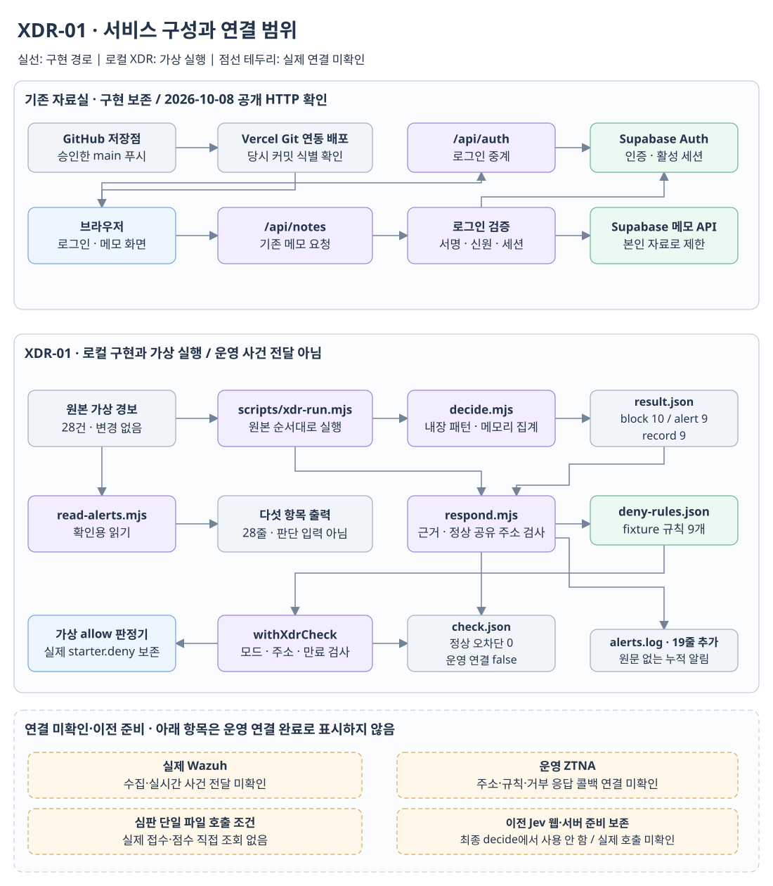
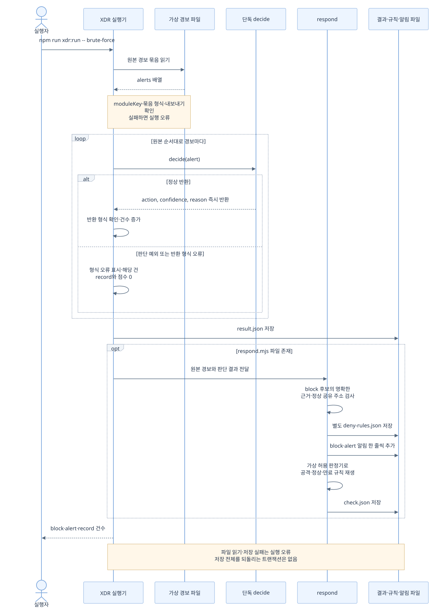
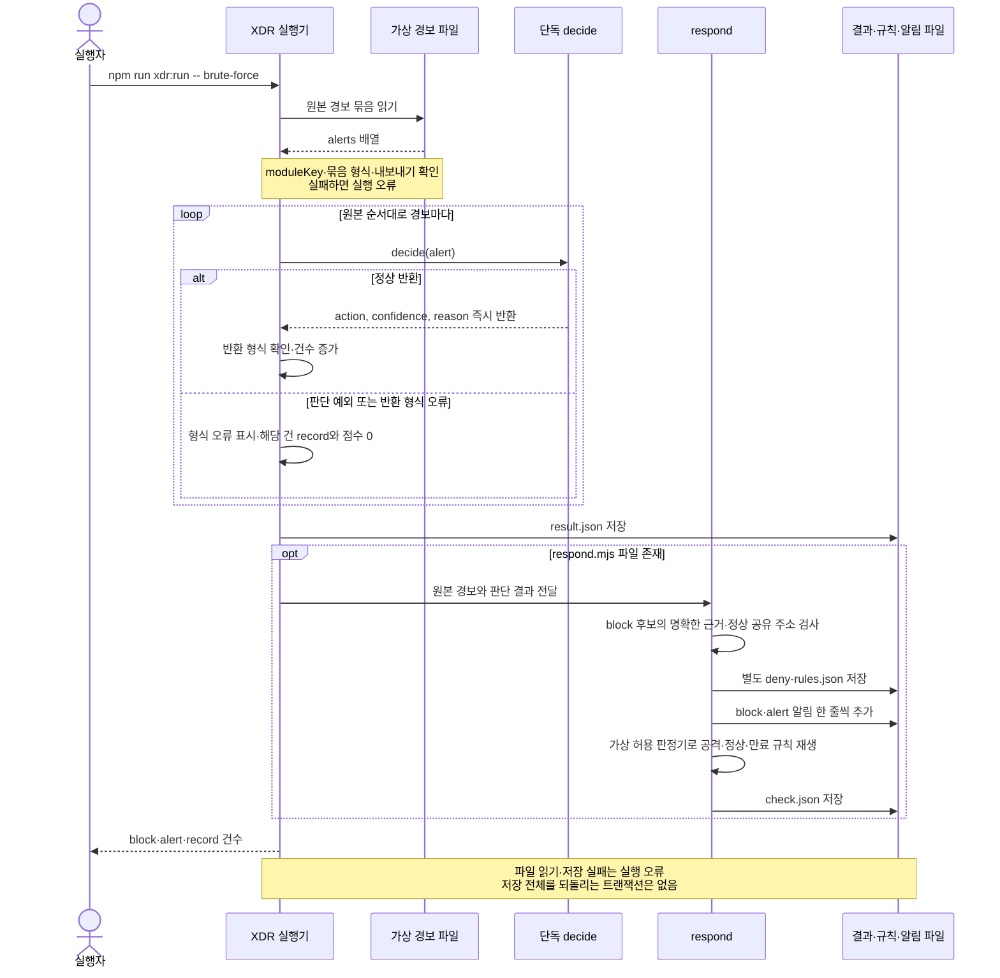
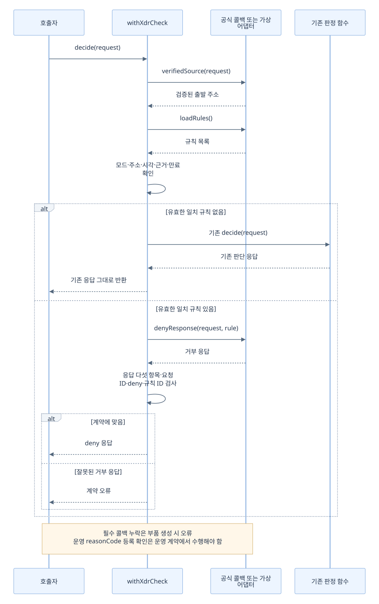
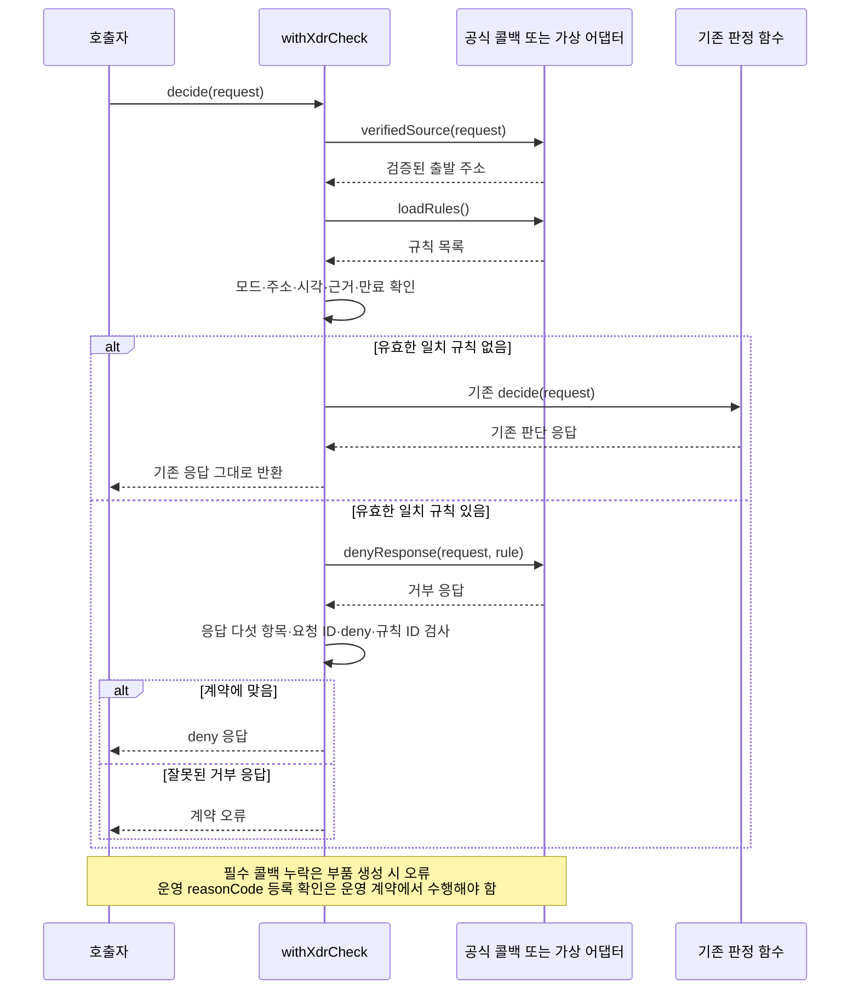
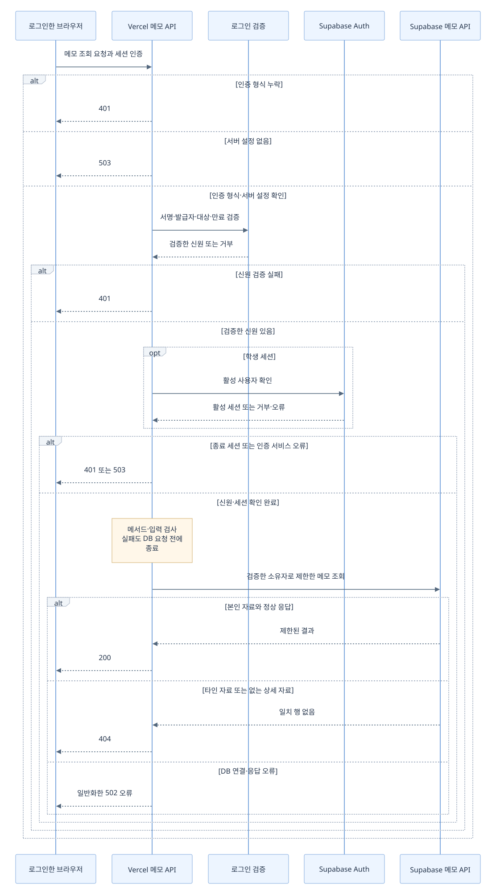
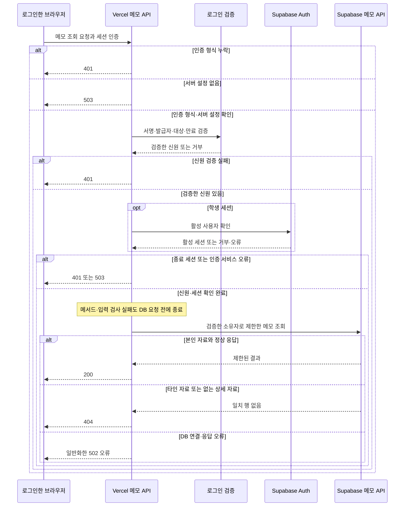
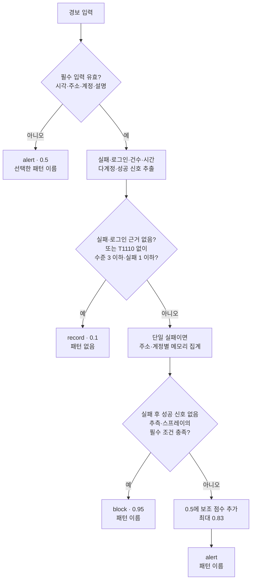

# XDR-01 작업 설명: 구조·판단 근거·검증 기록

작성일: **2026-10-12**. 문서 표시 형식 보완: **2026-10-12** (HTML·draw.io·오프라인 그림 추가). 대상 작업: **2026-10-07~08에 이 대화에서 수행한 XDR-01 제작과 제출 준비**.

이 문서는 실제 코드, 저장된 결과, 기존 작업 기록과 이 대화의 실행 결과를 대조한 설명입니다.
이번 문서 작성에서는 프로그램·설정·데이터를 변경하지 않았으며 시험 재실행·파일 이동·커밋·푸시·배포를 하지 않습니다.
과거 기록은 [XDR-01 README](D:/defense/choi-bujang-secret-vault-5-main/choi-bujang-secret-vault-5-main/xdr/brute-force/README.md)에 그대로 보존합니다.

| 기록 구분 | 이 문서에서 뜻하는 것 |
| --- | --- |
| 코드 확인 | 2026-10-12 로컬 파일을 읽고 확인한 구현. 운영에서 실행되었다는 뜻은 아님 |
| 가상 시험 | 수업용 경보·합성 요청·가짜 HTTP 응답으로 실행한 시험 |
| 실제 서비스 확인 | 2026-10-08 공개 배포 주소에 실제 HTTP 요청을 보내 관찰한 결과 |
| 사용자 제공 결과 | 사용자 또는 기존 문서가 전달한 확인. 이 문서 작성자가 새로 조회한 결과와 구분 |
| 미확인 | 실제 연결·배포·응답·접수를 확인한 증거가 없는 부분 |

## 1. 작업 개요

### 목표와 최종 요구사항

Wazuh 형태의 로그인 실패 경보를 모아 비밀번호 추측과 여러 계정에 대한 같은 비밀번호 대입을 구분합니다.
명확한 공격은 차단 후보, 애매한 시도는 알림, 정상 이벤트는 기록으로 남깁니다.
ZTNA의 기존 판단을 보존하는 추가 검사 부품이며 기존 규칙을 대신하지 않습니다.

최종 제작 요청은 다음 다섯 부분입니다.

| 제작 | 요구사항 | 실제 수행 |
| --- | --- | --- |
| 1 · 읽기 | 시각·출발 주소·계정·규칙 수준·설명만 추출, 비밀값 출력 제외 | 확인용 읽기 모듈 유지·실행, 원본 28건과 추출 28줄 확인 |
| 2 · 패턴 | MITRE T1110 근거의 이름·조건·근거 한 줄 | 비밀번호 추측·스프레이 두 패턴 작성·확인. 최종 요청에서 추가 패턴 없음 |
| 3 · 판단 | 한 파일, 하나의 동기 내보내기, 외부 의존·파일 입출력·외부 질문 금지 | 패턴을 파일 맨 위 상수로 복사, Jev 연결을 제출용 판단에서 제거 |
| 4 · 응답 | 별도 respond.mjs에서 알림과 만료·근거가 있는 거부 규칙 처리 | 명확한 근거 재확인·정상 주소 제외·기존 응답 보존·가상 재생 구현 |
| 5 · 실행 | 결과와 세 행동의 건수, 정상 오차단 확인 | 명령 실행, 결과 갱신, block 10·alert 9·record 9·정상 오차단 0 |

초기에는 애매한 경보를 Jev에 묻는 요구가 있었고 연결 코드와 가상 시험을 만들었습니다.
이후 사용자가 **인터넷 없이 decide.mjs 하나만 불러오는 요구**로 변경하여 최종 제출 경로를 독립 계산 방식으로 바꿨습니다.
이전 Jev 코드·화면·SQL 준비는 로컬의 다른 변경으로 보존하고 최종 XDR 저장점에서 제외했습니다.

23andMe 사고 설명은 사용자가 제공한 참고 맥락입니다.
그 설명만으로 자격 증명 재사용 탐지나 2단계 인증 요구를 새 규칙으로 구현하지 않았습니다.

### 수행 범위의 경계

- 실제 제작·확인: XDR-01 읽기, 두 패턴, 독립 판단, 응답 연결 부품, 가상 재생, 결과·알림·거부 규칙, 시험과 작업 기록.
- 실제 제출 준비: XDR 변경 11개 파일의 저장점, GitHub main 푸시, 해당 커밋의 Vercel 배포 식별 확인.
- 보존: 기존 로그인·메모 API·학습 DB·원본 경보·ZTNA 시작 틀·다른 미커밋 작업.
- 미확인: 실제 Wazuh 수집, 운영 엔진의 출발 주소 제공, 운영 ZTNA 차단, 실제 Jev 응답, 심판 접수·점수의 직접 조회.
- 후속 XDR-02·Git 이력 정리는 별도 작업입니다. 이번 문서가 그 기능을 새로 제작하거나 배포한 것으로 기록하지 않습니다.

## 2. 전체 서비스 구성

실선은 구현 경로입니다. XDR 실선은 **로컬 가상 실행 경로**이며 운영 사건 전달을 뜻하지 않습니다.
점선은 제출 조건·연결 구상 또는 실제 연결 미확인 부분입니다. 각 노드의 상태도 함께 읽어야 합니다.



[편집 가능한 draw.io 원본](diagrams/service-overview.drawio) · [SVG 크게 보기](diagrams/service-overview.svg)

**중요한 연결 차이:** 실행기는 원본 경보를 직접 판단 모듈에 넘깁니다.
확인용 읽기 출력이 실행기의 필수 중간 입력은 아닙니다.
decide.mjs는 read-alerts.mjs·patterns.json·evidence.mjs·respond.mjs를 불러오지 않습니다.
patterns.json과 맨 위 상수의 일치는 시험으로 확인합니다.

[실제 ZTNA 계약](D:/defense/choi-bujang-secret-vault-5-main/choi-bujang-secret-vault-5-main/docs/DECIDER_REQUEST.md)에는 출발 IP 항목이 없습니다.
withXdrCheck는 검증된 주소 조회·규칙 조회·거부 응답을 콜백으로 받도록 작성했으나,
해당 운영 콜백과 실제 접속 경로가 연결된 증거는 없습니다.
자료실의 /api/notes가 이 XDR 검사 함수를 자동 호출하는 경로도 이번에 구현하지 않았습니다.

## 3. 요청과 실행 순서

그림의 순서는 코드 호출 관계입니다. 처리 시간을 측정하지 않았으므로 지연 시간을 넣지 않았습니다.
**3분 집계 창과 15분 만료는 정책 설정이며 요청 처리 시간 측정값이 아닙니다.**

### 3.1 로컬 경보 실행과 결과 저장



<details>
<summary>Mermaid 수정 원본</summary>



</details>

[SVG 크게 보기](diagrams/xdr-sequence.svg) · [Mermaid 원본](diagrams/xdr-sequence.mmd)

반환 형식 오류를 record로 남기는 동작은 **실행기 오류 처리**입니다.
유효하지 않은 경보를 alert·0.5로 돌려주는 decide의 입력 검증과는 서로 다릅니다.
실행기는 결과를 먼저 쓰므로 이후 respond에서 오류가 나면 일부 파일만 갱신되었을 수 있습니다.

### 3.2 추가 검사 부품의 요청 처리

아래 순서는 실제 운영 접속 기록이 아니라 구현된 어댑터와 가상 재생에서 확인한 순서입니다.



<details>
<summary>Mermaid 수정 원본</summary>



</details>

[SVG 크게 보기](diagrams/gate-sequence.svg) · [Mermaid 원본](diagrams/gate-sequence.mmd)

기본 모드는 live이며 fixture 규칙을 적용하지 않습니다.
규칙이 없는 경우에도 기존 판정이 deny였다면 deny를 그대로 돌려줍니다.
가상 시험의 정상 통과는 **가상 allow 판정기를 연결한 결과**이며,
실제 starter.deny가 allow로 바뀌었다는 뜻이 아닙니다.

### 3.3 기존 자료실 메모 요청

자료실은 이번 XDR 작업에서 새로 구현한 기능이 아닙니다.
아래는 [메모 API](D:/defense/choi-bujang-secret-vault-5-main/choi-bujang-secret-vault-5-main/api/notes.js)와 [로그인 검사](D:/defense/choi-bujang-secret-vault-5-main/choi-bujang-secret-vault-5-main/src/verify-login.mjs)를 읽어 확인한 기존 흐름입니다.



<details>
<summary>Mermaid 수정 원본</summary>



</details>

[SVG 크게 보기](diagrams/notes-sequence.svg) · [Mermaid 원본](diagrams/notes-sequence.mmd)

그림은 메모 조회를 기준으로 합니다. 메서드·입력 검사에는 400·405 오류가 있고,
추가·수정 요청의 JSON 형식 검사에는 415 오류도 있습니다. 이 순서에 XDR 자동 차단 호출은 없습니다.
활성 세션·타인 메모 거부는 기존 방어를 확인한 내용이며 XDR에서 새로 추가한 보안 기능으로 표현하지 않습니다.

## 4. 주요 판단 로직

### 4.1 분기와 점수



<details>
<summary>Mermaid 수정 원본</summary>



</details>

[SVG 크게 보기](diagrams/decision-flow.svg) · [Mermaid 원본](diagrams/decision-flow.mmd)

최종 행동 변환은 **0.85 이상 block / 0.5 이상 alert / 그 아래 record**입니다.
현재 구현에서 명확한 조건은 0.95, 정상은 0.1, 애매한 실패는 0.5~0.83이므로 위 그림으로 분기를 통합했습니다.
confidence는 **패턴과의 일치 정도**이며 실제 공격 확률이나 모델 정확도 측정치가 아닙니다.

| 패턴 | 명확한 차단 후보 조건 | 근거 |
| --- | --- | --- |
| password_guessing | 로그인 실패 근거, 규칙 수준 10 이상, 실패 후 성공 신호 없음. 동일 주소·계정의 단일 실패 20건 이상을 180초 창에서 집계하거나, 요약 실패 20건 이상과 아래 시간·반복 조건 충족 | [MITRE T1110.001](https://attack.mitre.org/techniques/T1110/001/) |
| password_spraying | 실패 근거, 규칙 수준 10 이상, 성공 신호 없음, 같은 비밀번호 대입이라는 설명 신호, 서로 다른 계정 8개 이상 | [MITRE T1110.003](https://attack.mitre.org/techniques/T1110/003/) |

추측 요약 경보에 시간이 적혀 있으면 **0초 초과·180초 이하**여야 합니다.
시간이 없으면 명시적인 반복 대입 또는 성공 없음 신호를 사용합니다.
시간이 창보다 길다고 적혀 있는데 반복 표현만으로 짧은 시간 조건을 대신하지 않습니다.
스프레이의 현재 필수 조건에는 별도의 시간 창 검증이 없습니다.
여러 계정이라는 정보만으로 같은 비밀번호 대입을 추정하지 않으며 비밀번호 값 자체도 읽지 않습니다.

| 애매한 실패의 점수 구성 | 가산 |
| --- | --- |
| 기본 점수 | 0.50 |
| 규칙 수준 10 이상 | +0.08 |
| 요약 실패 또는 메모리 집계 5건 이상 | +0.08 |
| 설명에 유효한 180초 이하 창이 있음 | +0.08 |
| 반복 표현 또는 같은 비밀번호 신호 | +0.06 |
| 규칙의 T1110 표식 | +0.03 |

위 숫자는 수업용 구현 기준이며 MITRE가 지정한 임계값이 아닙니다.
패턴 이름은 같은 비밀번호 설명 신호가 있으면 password_spraying, 그 외에는 password_guessing입니다.
정상은 '패턴 없음'을 반환하며, 입력의 action·confidence·reason을 그대로 믿지 않습니다.

### 4.2 집계·정보 보호·적용 범위

- 단일 실패(count가 1 이하)이고 성공 후 신호가 없을 때만 주소·계정별 메모리에 넣습니다.
  시간 창 밖 기록과 같은 경보 ID를 중복 합산하지 않습니다. ID가 없으면 시각을 중복 구분값으로 사용합니다.
- 건수가 이미 요약된 경보를 단일 실패 기록에 다시 더하지 않습니다.
  모듈 인스턴스를 새로 만들면 집계가 초기화되며 프로세스 간 공유 저장소는 없습니다.
- 읽기 모듈은 문서용 주소·가상 계정만 출력하고 민감 설명을 제외합니다.
  단독 판단의 IPv4 검증은 그 가상 대역 제한과 다릅니다. 반환에는 주소·계정·설명 원문을 넣지 않습니다.
- 확인용 다섯 항목에는 추가 건수·계정 목록·MITRE 표식이 빠질 수 있습니다.
  읽기 출력으로 판단하면 원본의 모든 정보가 복원되지는 않습니다. 실행기는 원본을 전달합니다.
- 설명의 한국어 신호를 해석하는 연습 구현입니다. 임의의 실제 Wazuh 필드·언어·환경 전체에 대한 탐지 성능은 검증하지 않았습니다.
- 실패 후 성공은 현재 차단 후보를 낮추는 조건입니다. 공격자가 성공한 경우까지 정상이라고 검증한 것은 아닙니다.

### 4.3 판단 후 차단 규칙의 별도 검사

| 단계 | respond.mjs의 처리 | 이유 |
| --- | --- | --- |
| 후보 선택 | action=block, confidence 0.85 이상, 허용된 가상 경보 번호 | 결과 형식만으로 주소를 막지 않음 |
| 근거 확인 | 원본의 명확한 패턴 또는 동일 주소·계정의 20건 집계 근거 재확인 | 애매한 결과의 과도한 자동 차단 방지 |
| 정상 공유 주소 | 차단 기간에 같은 주소의 record 사건이 있으면 해당 주소 규칙 제외 | 주소 전체 차단으로 정상 사용자가 영향받는 경우 방지 |
| 유효 기간 | 원래 경보 시각부터 15분, startsAt 이상·expiresAt 미만 | 재실행 시 현재 시각으로 차단을 되살리지 않음 |
| 기록 | 별도 fixture 거부 규칙, 근거 경보 ID, block·alert 알림 | 기존 규칙·원문 보존 |
| 적용 | mode 일치·주소·근거·유효 시각 검사 후 거부 응답 | live 기본 모드에 가상 규칙이 섞이지 않음 |

알림은 record를 제외한 두 행동을 누적합니다. 반복 실행은 새 알림 줄을 더하므로 중복 제거 기능을 구현했다고 기록하지 않습니다.
규칙이 같은 주소에서 유효 기간이 겹치면 근거 ID와 만료를 합칩니다.
현재 저장된 후보 10건이 주소 규칙 9개인 이유도 같은 주소의 후보가 합쳐졌기 때문입니다.

## 5. 파일별 역할과 변경 이유

'기존 역할'의 기준은 **2026-10-07 XDR-01 제작 시작 전**입니다. 신규 파일의 이후 수정은 추가·변경 이유에 구분합니다. 기존 파일은 당시 역할을 적고, 중간 Jev 단계와 최종 오프라인 단계의 차이도 표시합니다.
2026-10-12 문서 작성 중에는 아래 프로그램 파일을 수정하지 않았습니다.

### 5.1 XDR 제작·제출에 포함한 파일

| 파일명 | 기존 역할 | 현재 역할 | 추가·변경 이유 |
| --- | --- | --- | --- |
| [read-alerts.mjs](D:/defense/choi-bujang-secret-vault-5-main/choi-bujang-secret-vault-5-main/xdr/brute-force/read-alerts.mjs) | <span class="badge-new" style="display:inline-block;background:#edf5ff;border:1px solid #b8d4f2;border-radius:999px;padding:1px 9px;color:#245c92;font-size:0.88em;white-space:nowrap">신규</span> | 원본 읽기·다섯 항목 추출·민감값 제외 | 안전한 확인용 출력 분리 · 초기 신규, 최종 단계에서는 확인만; 이전 단계: 경보 fixture만 있었음 |
| [patterns.json](D:/defense/choi-bujang-secret-vault-5-main/choi-bujang-secret-vault-5-main/xdr/brute-force/patterns.json) | <span class="badge-new" style="display:inline-block;background:#edf5ff;border:1px solid #b8d4f2;border-radius:999px;padding:1px 9px;color:#245c92;font-size:0.88em;white-space:nowrap">신규</span> | 두 패턴·조건·MITRE 근거 | 근거 있는 탐지 기준 기록 · 초기 신규, 최종 단계에서는 확인만; 이전 단계: 이 도구의 패턴 파일 없음 |
| [decide.mjs](D:/defense/choi-bujang-secret-vault-5-main/choi-bujang-secret-vault-5-main/xdr/brute-force/decide.mjs) | <span class="badge-new" style="display:inline-block;background:#edf5ff;border:1px solid #b8d4f2;border-radius:999px;padding:1px 9px;color:#245c92;font-size:0.88em;white-space:nowrap">신규</span> | 패턴 내장·단일 동기 내보내기·메모리 집계 | 오프라인 단일 파일 심판 계약 준수 · 초기 신규 후 변경; 이전 단계: 초기에는 패턴 파일·판단 공통 코드·Jev 연결에 의존 |
| [evidence.mjs](D:/defense/choi-bujang-secret-vault-5-main/choi-bujang-secret-vault-5-main/xdr/brute-force/evidence.mjs) | <span class="badge-new" style="display:inline-block;background:#edf5ff;border:1px solid #b8d4f2;border-radius:999px;padding:1px 9px;color:#245c92;font-size:0.88em;white-space:nowrap">신규</span> | 응답 부품의 원본 근거·집계 재확인 | 차단 후보를 별도로 검증 · 초기 신규, 최종 단계 확인; 이전 단계: 공통 근거 계산 없음 |
| [respond.mjs](D:/defense/choi-bujang-secret-vault-5-main/choi-bujang-secret-vault-5-main/xdr/brute-force/respond.mjs) | <span class="badge-new" style="display:inline-block;background:#edf5ff;border:1px solid #b8d4f2;border-radius:999px;padding:1px 9px;color:#245c92;font-size:0.88em;white-space:nowrap">신규</span> | 규칙·알림·파일 쓰기·추가 검사·가상 재생 본체 | 사용자가 요청한 판단과 응답 책임 분리 · 최종 단계 신규; 이전 단계: 기능이 connect.mjs에 있었음 |
| [connect.mjs](D:/defense/choi-bujang-secret-vault-5-main/choi-bujang-secret-vault-5-main/xdr/brute-force/connect.mjs) | <span class="badge-new" style="display:inline-block;background:#edf5ff;border:1px solid #b8d4f2;border-radius:999px;padding:1px 9px;color:#245c92;font-size:0.88em;white-space:nowrap">신규</span> | respond.mjs 함수 재내보내기 | 이전 호출 경로 보존 · 초기 신규 후 변경; 이전 단계: 연결·저장 본체 |
| [scripts/xdr-run.mjs](D:/defense/choi-bujang-secret-vault-5-main/choi-bujang-secret-vault-5-main/scripts/xdr-run.mjs) | 기존 경보별 decide 실행과 결과 생성, 이후 connect 호출 | XDR-01 결과 뒤 respond 호출 | 새 응답 파일 연결, 판단 파일의 Jev 통계 의존 제거 · 변경 |
| [test/xdr-brute-force.test.mjs](D:/defense/choi-bujang-secret-vault-5-main/choi-bujang-secret-vault-5-main/test/xdr-brute-force.test.mjs) | <span class="badge-new" style="display:inline-block;background:#edf5ff;border:1px solid #b8d4f2;border-radius:999px;padding:1px 9px;color:#245c92;font-size:0.88em;white-space:nowrap">신규</span> | 단독 파일·패턴 상수 일치·경계·정상·만료·보존 시험 | 새 제출 계약과 과도한 차단 방지 검증 · 초기 신규 후 변경; 이전 단계: 초기 읽기·패턴·Jev·연결 시험 |
| [test/xdr-run.test.mjs](D:/defense/choi-bujang-secret-vault-5-main/choi-bujang-secret-vault-5-main/test/xdr-run.test.mjs) | 기존 실행기·fixture 형식 시험 | 그대로 유지 | 결과 형식·예외 처리 확인 · 확인만 |
| [result.json](D:/defense/choi-bujang-secret-vault-5-main/choi-bujang-secret-vault-5-main/xdr/brute-force/result.json) | <span class="badge-new" style="display:inline-block;background:#edf5ff;border:1px solid #b8d4f2;border-radius:999px;padding:1px 9px;color:#245c92;font-size:0.88em;white-space:nowrap">신규</span> 실행 산출물 | 오프라인 판단 결과와 counts | 실제 재실행 결과 저장 · 실행 산출물 갱신 |
| [check.json](D:/defense/choi-bujang-secret-vault-5-main/choi-bujang-secret-vault-5-main/xdr/brute-force/check.json) | <span class="badge-new" style="display:inline-block;background:#edf5ff;border:1px solid #b8d4f2;border-radius:999px;padding:1px 9px;color:#245c92;font-size:0.88em;white-space:nowrap">신규</span> 실행 산출물 | 정상 오차단·규칙 수·가상 재생·연결 상태 | 판단과 규칙 적용을 별도 검증. 최종 재실행 값은 이전과 같음 · 초기 산출물 생성, 최종 결과 확인; 이전 단계: 오차단·재생 기록 없음 |
| [deny-rules.json](D:/defense/choi-bujang-secret-vault-5-main/choi-bujang-secret-vault-5-main/xdr/brute-force/deny-rules.json) | <span class="badge-new" style="display:inline-block;background:#edf5ff;border:1px solid #b8d4f2;border-radius:999px;padding:1px 9px;color:#245c92;font-size:0.88em;white-space:nowrap">신규</span> 실행 산출물 | 만료와 근거 ID가 있는 fixture 규칙 9개 | 기존 판정 규칙을 고치지 않는 후보 저장. 최종 값은 이전과 같음 · 초기 산출물 생성, 최종 결과 확인; 이전 단계: XDR 가상 거부 목록 없음 |
| [alerts.log](D:/defense/choi-bujang-secret-vault-5-main/choi-bujang-secret-vault-5-main/xdr/alerts.log) | <span class="badge-new" style="display:inline-block;background:#edf5ff;border:1px solid #b8d4f2;border-radius:999px;padding:1px 9px;color:#245c92;font-size:0.88em;white-space:nowrap">신규</span> 실행 산출물 | moduleKey·모드·가상 번호·행동·점수·패턴만 추가 | 원문 없는 공통 알림 기록, 최종 실행에서 19줄 추가 · 초기 생성 후 누적; 이전 단계: 이 도구의 알림 기록 없음 |

현재 실행기는 후속 XDR-02 작업으로 web-injection도 처리합니다.
이는 XDR-01 저장점 이후의 변경이며 이 문서의 XDR-01 제작 범위와 구분합니다.

### 5.2 이전 Jev 준비와 보존·확인 파일

| 파일명 | 기존 역할 | 현재 역할 | 추가·변경 이유 |
| --- | --- | --- | --- |
| [jev.mjs](D:/defense/choi-bujang-secret-vault-5-main/choi-bujang-secret-vault-5-main/xdr/brute-force/jev.mjs) | <span class="badge-new" style="display:inline-block;background:#edf5ff;border:1px solid #b8d4f2;border-radius:999px;padding:1px 9px;color:#245c92;font-size:0.88em;white-space:nowrap">신규</span> | 숫자·불리언 신호만 보내고 Noul 응답 검사 | 초기 Jev 요청 구현. 최종 decide에서는 사용하지 않음 · 이전 요구에서 신규; 이전 단계: 외부 판단 연결 없음 |
| [judgment.mjs](D:/defense/choi-bujang-secret-vault-5-main/choi-bujang-secret-vault-5-main/xdr/brute-force/judgment.mjs) | <span class="badge-new" style="display:inline-block;background:#edf5ff;border:1px solid #b8d4f2;border-radius:999px;padding:1px 9px;color:#245c92;font-size:0.88em;white-space:nowrap">신규</span> | 이전 Jev 판단 팩토리 | 웹 시험 준비 보존, 최종 제출 제외 · 로컬 신규·미커밋 |
| [api/ai.js](D:/defense/choi-bujang-secret-vault-5-main/choi-bujang-secret-vault-5-main/api/ai.js) | 501 시작 틀 | 로그인·가상 경보 번호·한도 예약·Jev 시험 중계 준비 | 사용자의 Vercel Jev 요청. 실제 설정·배포 미확인, 최종 저장점 제외 · 로컬 변경·미커밋 |
| [public/index.html](D:/defense/choi-bujang-secret-vault-5-main/choi-bujang-secret-vault-5-main/public/index.html) | 로그인·메모 화면 | 기존 기능과 별도의 Jev 시험 화면 준비 | 웹에서 시험 요청, 최종 저장점 제외 · 로컬 변경·미커밋 |
| [일일 한도 SQL](D:/defense/choi-bujang-secret-vault-5-main/choi-bujang-secret-vault-5-main/docs/sql/xdr-jev-usage.sql) | <span class="badge-new" style="display:inline-block;background:#edf5ff;border:1px solid #b8d4f2;border-radius:999px;padding:1px 9px;color:#245c92;font-size:0.88em;white-space:nowrap">신규</span> | 서버용 일일 한도 표·예약 함수 초안 | 반복 외부 호출 제한 준비. 학습 DB 적용 미실행 · 로컬 신규·미커밋 |
| [scripts/xdr-local.ps1](D:/defense/choi-bujang-secret-vault-5-main/choi-bujang-secret-vault-5-main/scripts/xdr-local.ps1) | <span class="badge-new" style="display:inline-block;background:#edf5ff;border:1px solid #b8d4f2;border-radius:999px;padding:1px 9px;color:#245c92;font-size:0.88em;white-space:nowrap">신규</span> | 이전 요구용 숨김 입력·실행 후 정리 | 비밀값 파일 저장 방지. 현재 오프라인 실행에는 불필요 · 로컬 신규·미커밋 |
| [test/xdr-ai.test.mjs](D:/defense/choi-bujang-secret-vault-5-main/choi-bujang-secret-vault-5-main/test/xdr-ai.test.mjs) | <span class="badge-new" style="display:inline-block;background:#edf5ff;border:1px solid #b8d4f2;border-radius:999px;padding:1px 9px;color:#245c92;font-size:0.88em;white-space:nowrap">신규</span> | 합성 인증·가짜 RPC·HTTP 시험 | 실제 키·DB·모델 없이 서버 분기 확인 · 로컬 신규·미커밋 |
| [notes-ui 시험](D:/defense/choi-bujang-secret-vault-5-main/choi-bujang-secret-vault-5-main/test/notes-ui.test.mjs)·[패키지 시험](D:/defense/choi-bujang-secret-vault-5-main/choi-bujang-secret-vault-5-main/test/package-starter.test.mjs)·[구성 안내](D:/defense/choi-bujang-secret-vault-5-main/choi-bujang-secret-vault-5-main/package/ARCHITECTURE.md) | 기존 화면·시작 틀 기준 | 이전 웹 준비에 맞춘 시험·안내 | 다른 작업으로 보존, 최종 XDR 저장점 제외 · 로컬 변경·미커밋 |
| [src/decider.mjs](D:/defense/choi-bujang-secret-vault-5-main/choi-bujang-secret-vault-5-main/src/decider.mjs) | starter.deny | 함수·다섯 응답 항목·규칙 이름 유지 | 기존 판정 계약 보존 · 확인만 |
| [원본 경보](D:/defense/choi-bujang-secret-vault-5-main/choi-bujang-secret-vault-5-main/xdr/fixtures/brute-force.json) | 수업용 경보 28건 | 원본 그대로 | 시험 입력을 바꿔 결과를 맞추지 않음 · 확인만 |
| [aleph.config.json](D:/defense/choi-bujang-secret-vault-5-main/choi-bujang-secret-vault-5-main/aleph.config.json) | 5단계·배포·발급자·허용 경로·원본 API 설정 | 같은 설정 유지 | 구현과 대조, judgeIssuer 보존 · 확인만 |
| [api/auth.js](D:/defense/choi-bujang-secret-vault-5-main/choi-bujang-secret-vault-5-main/api/auth.js)·[api/notes.js](D:/defense/choi-bujang-secret-vault-5-main/choi-bujang-secret-vault-5-main/api/notes.js)·[verify-login.mjs](D:/defense/choi-bujang-secret-vault-5-main/choi-bujang-secret-vault-5-main/src/verify-login.mjs) | 기존 인증·소유자 방어 | 그대로 유지 | XDR 작업을 기존 방어의 새 구현으로 혼동하지 않음 · 확인만 |
| [src/attack-check.mjs](D:/defense/choi-bujang-secret-vault-5-main/choi-bujang-secret-vault-5-main/src/attack-check.mjs)·[bundle.mjs](D:/defense/choi-bujang-secret-vault-5-main/choi-bujang-secret-vault-5-main/scripts/bundle.mjs) | 5단계 자기 점검과 제출 묶음 | 그대로 유지 | XDR 제출 방식과 기존 5단계 묶음을 구분 · 확인만 |

### 5.3 문서와 로컬 검토 산출물

기존 [루트 README](D:/defense/choi-bujang-secret-vault-5-main/choi-bujang-secret-vault-5-main/README.md), [TODO](D:/defense/choi-bujang-secret-vault-5-main/choi-bujang-secret-vault-5-main/TODO.md), [XDR 목차](D:/defense/choi-bujang-secret-vault-5-main/choi-bujang-secret-vault-5-main/xdr/README.md),
[XDR-01 기록](D:/defense/choi-bujang-secret-vault-5-main/choi-bujang-secret-vault-5-main/xdr/brute-force/README.md)은 구현·현재 상태·재실행 방법을 안내하도록 갱신했습니다.
이 파일들은 최종 11개 파일 저장점에 포함했습니다.

[제출 전 검사 기록](D:/defense/choi-bujang-secret-vault-5-main/choi-bujang-secret-vault-5-main/artifacts/xdr-01/preflight.json)과
[단독 판단 사본](D:/defense/choi-bujang-secret-vault-5-main/choi-bujang-secret-vault-5-main/artifacts/xdr-01/decide.mjs)은 Git 제외인 로컬 검토 산출물입니다.
공식 제출 묶음이나 심판 판정 결과가 아닙니다.
검토용 전체 사본은 검증 후 정리했고 원래 작업 파일은 보존했습니다.

이번 문서 작업은 IMPLEMENTATION.md 보완, 작업정리.html 신규 작성, diagrams/의 draw.io·Mermaid 원본과 SVG·수정 안내 작성, 기존 XDR-01 README 안내 추가입니다. 프로그램 파일은 수정하지 않았습니다.
다른 문서와 코드의 미커밋 상태를 이번 변경으로 취합하지 않습니다.

| 파일명 | 기존 역할 | 현재 역할 | 추가·변경 이유 |
| --- | --- | --- | --- |
| IMPLEMENTATION.md | <span class="badge-new" style="display:inline-block;background:#edf5ff;border:1px solid #b8d4f2;border-radius:999px;padding:1px 9px;color:#245c92;font-size:0.88em;white-space:nowrap">신규</span> (2026-10-12 최초 정리) | 수정용 상세 기록 | 기존 코드·결과·과거 기록을 설명하고 HTML 표시 형식 보완 |
| 작업정리.html | <span class="badge-new" style="display:inline-block;background:#edf5ff;border:1px solid #b8d4f2;border-radius:999px;padding:1px 9px;color:#245c92;font-size:0.88em;white-space:nowrap">신규</span> | 목차·표·로컬 그림을 갖춘 전체 열람본 | PC에서 더블클릭·오프라인 열람 |
| diagrams/service-overview.drawio | <span class="badge-new" style="display:inline-block;background:#edf5ff;border:1px solid #b8d4f2;border-radius:999px;padding:1px 9px;color:#245c92;font-size:0.88em;white-space:nowrap">신규</span> | 편집 가능한 대표 구성도 | 구현과 미연결 범위를 구분 |
| diagrams/*.mmd·mermaid-theme.json | <span class="badge-new" style="display:inline-block;background:#edf5ff;border:1px solid #b8d4f2;border-radius:999px;padding:1px 9px;color:#245c92;font-size:0.88em;white-space:nowrap">신규</span> | 시퀀스·조건 분기 원본과 표시 설정 | 코드 호출 순서·조건을 수정 가능하게 보관 |
| diagrams/*.svg | <span class="badge-new" style="display:inline-block;background:#edf5ff;border:1px solid #b8d4f2;border-radius:999px;padding:1px 9px;color:#245c92;font-size:0.88em;white-space:nowrap">신규</span> 실행 산출물 | 구성도 1개·시퀀스 3개·분기 1개의 로컬 그림 | 외부 렌더러 없이 열람 |
| diagrams/README.md | <span class="badge-new" style="display:inline-block;background:#edf5ff;border:1px solid #b8d4f2;border-radius:999px;padding:1px 9px;color:#245c92;font-size:0.88em;white-space:nowrap">신규</span> | 그림 파일 대응과 수정 안내 | 이동·수정·재생성의 조건 안내 |
| xdr/brute-force/README.md | 기존 XDR-01 작업 기록 | 과거 내용 보존·새 문서 링크 추가 | 기존 기록에서 HTML과 원본을 찾기 쉽게 안내 |

## 6. 검증과 결과

### 6.1 실제 실행한 명령: 당시의 결과

아래는 2026-10-07~08 작업에서 실행한 기록입니다. **2026-10-12에 다시 실행한 결과가 아닙니다.**
동일 명령의 시험 개수는 요구 변경·미커밋 시험 포함 여부에 따라 달라졌습니다.

| 당시 실행 명령·작업 | 결과 | 검증 구분 |
| --- | --- | --- |
| node xdr/brute-force/read-alerts.mjs | 경보 28건·출력 28줄·다섯 항목 이외 출력 0줄 | 가상 입력 실제 실행 |
| node --test test/xdr-brute-force.test.mjs test/xdr-run.test.mjs | 최종 요구 적용 후 15개 통과 | 가상 시험 |
| node --test test/*.test.mjs | 당시 로컬 미커밋 Jev 서버 시험 포함 51개 통과 | 가상 시험, 실제 외부 서비스 사용 아님 |
| 제출 사본에서 node --test test/*.test.mjs | 저장점에 포함할 파일만 검증, 47개 통과 | 가상 시험, 제외한 Jev 시험 4개와 구분 |
| npm.cmd run xdr:run -- brute-force | result·check·규칙 갱신, 알림 19줄 추가 | 가상 입력·가상 허용 판정기 |
| npm.cmd run build -- --local | 이전 Jev 웹 준비 시점 정적 빌드 성공 | 정적 빌드, 서버·DB·배포 시험 아님 |
| node --input-type=module로 검사 스크립트 실행 | 단독 사본의 유일 내보내기·동기 반환·형식·점수 경계·민감 패턴 검사 통과 | 로컬 제출 전 검사 |
| 실행 전후 SHA-256 비교 | 원본 경보·기존 판정기·config 보존 확인 | 파일 보존 검사 |
| git diff --check, git diff --cached --check | 공백 오류 없음 | 변경·스테이징 검사 |
| git commit -m '보너스 xdr-01 저장점' | 최종 XDR 변경 11개 파일 저장 | 실제 Git 작업 |
| git push origin HEAD:main | 승인 후 연결된 저장소 main에 반영 | 실제 원격 반영 |

PowerShell 숨김 입력 보조 도구는 구문 검사와 합성 입력·가짜 npm을 사용하는 시험만 수행했습니다.
학생의 실제 키 입력이나 실제 Jev 응답을 확인했다고 기록하지 않습니다.

첫 실패한 시험은 금지 항목 검사식이 패턴의 require 항목까지 함수 호출로 인식한 오류였습니다.
require(...) 호출 여부만 검사하도록 시험 한 곳을 수정한 후 15개가 통과했습니다.
Windows 보조 도구 시험의 실행 정책·합성 입력 의존성 문제를 수정한 이력은 기존 README에 보존했습니다.

### 6.2 저장된 XDR 결과

근거는 [result.json](D:/defense/choi-bujang-secret-vault-5-main/choi-bujang-secret-vault-5-main/xdr/brute-force/result.json)과
[check.json](D:/defense/choi-bujang-secret-vault-5-main/choi-bujang-secret-vault-5-main/xdr/brute-force/check.json)입니다. 데이터 본문은 이 문서에 복사하지 않습니다.

| 확인 항목 | 저장된 결과 | 의미 |
| --- | --- | --- |
| block / alert / record | 10 / 9 / 9 | 28건의 가상 경보 판단 |
| 정상 이벤트 / 정상 block | 9 / 0 | 이 가상 정상 집합의 판단 오차단 없음 |
| 정상 주소 차단 | 0 | 별도 규칙 적용에서 정상 주소 제외 |
| 주소 규칙 | 9 | 명확한 후보 10건을 주소별로 합침 |
| 명확한 공격 재생 | 10/10 거부 | 가상 추가 검사 deny |
| 애매한 시도 재생 | 9/9 통과 | 차단하지 않고 alert 유지 |
| 정상 요청 재생 | 9/9 통과 | 가상 기존 allow 응답 유지 |
| 만료 규칙 재생 | 9/9 통과 | expiresAt부터 적용하지 않음 |
| Jev 호출·응답·실패 | 모두 0 | 최종 실행은 외부 판단 사용 안 함 |
| liveZtnaConnected | false | 실제 운영 연결 완료 아님 |

수준만 높이거나 T1110 표식만 붙인 정상 사건, 입력의 임의 점수, 실패 건수 19/20,
시간 창 180/181초, 수준 9/10, 계정 수 7/8, 실패 후 성공, 중복·다른 계정·시간 창 밖 실패,
정상과 공유한 주소, 필수 어댑터 누락 및 기존 응답 보존을 시험했습니다.
잘못된 거부 응답을 계약 오류로 처리하는 분기는 코드를 읽어 확인했으며,
이 대화의 최종 시험에서 그 응답 오류를 직접 발생시켰다고 기록하지 않습니다.
이 작은 가상 집합으로 운영 전체의 탐지율·오차단율을 측정한 것은 아닙니다.

### 6.3 실제 서비스 확인과 사용자 제공 결과

2026-10-08 푸시 후 Node의 fetch로 공개 주소에 GET 요청을 보냈습니다.
일반 실행 환경에서 요청 실패가 나자 승인된 네트워크 실행으로 확인했습니다.
본문·토큰·키는 출력하거나 이 문서에 넣지 않았습니다.

| 실제 GET 경로 | 당시 관찰 | 확인의 범위 |
| --- | --- | --- |
| /aleph.json | HTTP 200, 당시 저장점 63db3cb와 커밋 일치, 단계 5·저장소·원본 주소·경로 수 확인 | 새 코드의 배포 식별 확인 |
| / | HTTP 200, 보안 헤더 확인, 첫 HTML의 키 표식 미검출 | 첫 응답 검사. 모든 동적 자원 검사 아님 |
| /api/notes | HTTP 401 | 무로그인 거부. 본인 메모 CRUD 새 시험 아님 |
| /data.json | HTTP 404 | 해당 공개 경로 차단. 당시 과거 Git 본문 제거 여부 검사 아님 |

배포 URL: [자료실](https://choi-bujang-secret-vault-5.vercel.app).
저장소 URL: [GitHub](https://github.com/lee5299/choi-bujang-secret-vault-5).

기존 [5단계 기록](D:/defense/choi-bujang-secret-vault-5-main/choi-bujang-secret-vault-5-main/5/README.md)은 DB 권한 회수와 본인 CRUD·타인 자료 거부를 사용자 화면·시험으로 확인했다고 구분합니다.
이는 기존 방어 결과이며 XDR가 그 기능을 새로 추가한 결과가 아닙니다.
후속 [프로젝트 안내](D:/defense/choi-bujang-secret-vault-5-main/choi-bujang-secret-vault-5-main/docs/PROJECT_PAGE.md)에는 사용자가 과제 100점 통과를 알려준 기록이 있습니다.
그 사용자 제공 기록만으로 XDR-01의 실제 운영 차단이나 Jev 성능을 입증하지 않으며,
이 대화에서는 XDR-01 심사 프로그램의 접수·점수를 직접 조회한 결과가 없습니다.

### 6.4 저장점·배포 시점과 후속 이력

| 시점 | 실제 수행·근거 | 주의 |
| --- | --- | --- |
| 2026-10-07 | 초기 제작과 Jev 단계 저장점·가상 시험 기록 | 당시 요구이며 최종 오프라인 요구와 구분 |
| 2026-10-08 오프라인 저장점 | 당시 커밋 63db3cb151114ccf6466c6a7d9a4d28beba77f37, 변경 11개 파일, 대상 검사 미검출 | 당시 대화·로컬 preflight의 ID |
| 같은 날 원격·배포 | 정확한 저장소 main 푸시 승인 후 성공, /aleph.json의 당시 커밋 일치 확인 | 실제 심판 실행과 구분 |
| 후속 Git 이력 정리 이후 | 현재 이력의 XDR-01 오프라인 저장점 b3c125877a604b1df8b3505cf9ae66b59b409802 | 과거 ID를 현재 HEAD라고 안내하지 않음 |
| 2026-10-12 문서 대조 | 현재 파일·Git 기록·저장된 결과 읽기 | 새 테스트·배포·점수 조회 없음 |

현재 ID 변화는 별도 [Git 이력 정리 기록](D:/defense/choi-bujang-secret-vault-5-main/choi-bujang-secret-vault-5-main/docs/GIT_HISTORY_CLEANUP.md)과 대조했습니다.
그 작업은 다른 시점의 작업이며 여기에서 재실행하지 않습니다.
현재 이력에는 후속 XDR-02와 데이터 이력 정리 저장점도 있으므로,
2026-10-08 XDR-01 배포 확인을 현재 최신 배포 확인으로 바꾸어 표현하지 않습니다.

최초 main 푸시는 자동 승인 검토에서 정확한 대상의 구체적 승인 부족으로 거절되었습니다.
사용자가 저장소 주소와 main을 지정해 승인한 뒤 같은 대상에 정상 푸시했습니다.
다른 브랜치나 우회 경로로 거절된 작업을 실행하지 않았습니다.

### 6.5 미실행·미확인 항목

- 운영 Wazuh 연결, 실시간 사건 전달, 실제 출발 주소 콜백, 운영 거부 이유 코드 등록.
- 실제 운영 접속 차단·회수, 정상 학생 접속의 XDR 추가 검사 통과.
- 실제 Jev API 응답, 운영 데이터에서 규칙 방식과 Jev 방식의 성능 비교.
- Jev 일일 한도 SQL의 DB 적용·동시 요청 제어, Jev 웹 준비 코드의 Vercel 배포.
- 이번 XDR 제출 과정에서 npm run bundle 실행. 해당 도구는 기존 5단계 제출 형식이며 이번 XDR 제출 파일 검사와 구분함.
- 심판 프로그램에 실제 접수하고 점수를 직접 조회하는 작업.
- 운영 경보 전체에 대한 탐지율·오차단율, 처리 시간·지연·부하·비용 측정.

남은 연결은 [TODO](D:/defense/choi-bujang-secret-vault-5-main/choi-bujang-secret-vault-5-main/TODO.md)에 유지합니다.

## 7. 사용자 제안으로 수행한 추가 확인·개선

핵심 제작 다섯 항목과 구분한 사용자 제안·범위 확인입니다.

| 제안·질문 | 이유 | 수행한 조치 | 검증·한계 |
| --- | --- | --- | --- |
| 인터넷의 알려진 무차별 로그인 패턴을 찾아 달라는 요청 | 임의 패턴 방지 | MITRE T1110.001·T1110.003 근거 확인·두 패턴 등록 | 한 줄 근거·상수 사본 일치 확인. 패턴 수가 늘었다고 효과를 주장하지 않음 |
| Wazuh 공식 규칙 복사 여부 질문과 원래 범위로 복귀 요청 | 경보 읽기와 탐지 엔진 규칙 복사를 구분 | 한때 추가했던 Wazuh 원본 참조·참고 복사분을 제거하고 MITRE 패턴 방식 유지 | 최종 공식 XML 규칙 등록은 없음. 당시 되돌림 뒤 가상 시험·counts 확인 |
| XDR 여섯 항목을 한곳에 보관하는 질문 | 프로그램 위치·기록 찾기 혼란 감소 | xdr 공통 목차와 brute-force 상세 기록 분리 | 이 대화에서 나머지 다섯 과제를 추측해 새로 완성했다고 기록하지 않음 |
| 만들어 둔 읽기 모듈이 맞는지 재확인 요청 | 원본 보존·출력 계약 확인 | 모듈을 재작성하지 않고 28건·28줄·필드·해시 확인 | 기존 구현 확인이며 새 읽기 기능 추가가 아님 |
| Jev 키 발급·로컬 시험·Vercel 호출 요청 | 실제 연결 준비 | 숨김 입력 도구·인증된 서버 중계·한도 SQL·화면·가짜 응답 시험 준비 | 키 발급은 사용자 진술. 실제 키·모델·SQL 적용 미확인, 최종 저장점 제외 |
| URL·저장소 제출과 운영 엔진 위치의 관계 질문 | 제출 요건을 잘못 확대하지 않기 위함 | 운영 소스코드 제출 요구를 정정하고 공식 연결 계약 필요성 설명 | 출발 IP 계약을 임의로 만들지 않음. 운영 엔진을 새로 구현하지 않음 |
| 다른 홈페이지에 붙일 수 있는지 질문 | 재사용 범위 이해 | 판단·응답 부품과 사이트별 인증·주소·적용 연결의 차이 설명 | 다른 홈페이지로 실제 이식하거나 배포하지 않음 |
| Vercel 배포·저장소 주소로 심사받자는 요청 | 제출 가능한 최신 상태 준비 | XDR만 사본 검사·저장점·승인된 main 푸시·배포 커밋 및 무로그인 거부 확인 | 기존 자료실 방어 재확인. 새 심판 점수 직접 조회 없음 |
| Jev가 실제로 효과가 좋은지 질문 | 확신도와 실제 성능을 구분 | 공식 설명과 MITRE를 확인하고 동일 경보로 비교 시험이 필요하다고 설명 | 성능 개선 실험을 실행하지 않음. 높게 나온 점수를 정확도로 제시하지 않음 |

Jev 설명의 참고 근거는 [공식 확신도 문서](https://docs.typesafe.ai/confidence)입니다.
현재 confidence는 자체 패턴 점수이므로 Jev의 Noul 공격 확률과 같은 측정값으로 비교하지 않습니다.

## 8. 문서 보기·수정·재현 방법

### 문서와 그림 보기

- **작업정리.html을 더블클릭**하면 PC 브라우저에서 전체 기록과 목차를 볼 수 있습니다. 인터넷 연결 없이 본문과 다섯 SVG가 표시됩니다.
- 수정용 원본은 **IMPLEMENTATION.md**입니다. HTML은 원본을 읽기 쉽게 만든 정적 문서이며 자동 동기화하지 않습니다.
- 다른 PC에서는 **brute-force 폴더의 IMPLEMENTATION.md·작업정리.html·diagrams 폴더를 함께 복사**하세요. 프로그램·데이터를 복사할 필요는 없습니다.
- 본문에서 연결한 코드·시험·결과·과거 기록은 원래 자료실의 절대 경로입니다. 자료실이 없거나 위치가 달라지면 열리지 않습니다. 외부 근거 사이트도 인터넷이 필요하지만 본문·그림 열람에는 필요하지 않습니다.
- HTML 목차의 **2. 전체 서비스 구성**, **5. 파일별 역할**, **6. 검증과 결과**를 누르면 해당 위치로 이동합니다. 그림 아래 **SVG 크게 보기**로 확대할 수 있습니다.

### 다이어그램 원본과 수정 방법

| 내용 | 편집 원본 | 문서용 그림 |
| --- | --- | --- |
| 대표 서비스 구성 | [service-overview.drawio](diagrams/service-overview.drawio) | [service-overview.svg](diagrams/service-overview.svg) |
| 로컬 XDR 실행 | [xdr-sequence.mmd](diagrams/xdr-sequence.mmd) | [xdr-sequence.svg](diagrams/xdr-sequence.svg) |
| 추가 검사 부품 | [gate-sequence.mmd](diagrams/gate-sequence.mmd) | [gate-sequence.svg](diagrams/gate-sequence.svg) |
| 기존 메모 조회 | [notes-sequence.mmd](diagrams/notes-sequence.mmd) | [notes-sequence.svg](diagrams/notes-sequence.svg) |
| 판단 조건 분기 | [decision-flow.mmd](diagrams/decision-flow.mmd) | [decision-flow.svg](diagrams/decision-flow.svg) |

구성도는 draw.io에서 **File → Open from → Device**로 원본을 열고 수정한 뒤 SVG로 내보냅니다. SVG에도 같은 편집 데이터가 포함되어 있습니다.
Mermaid 원본은 .mmd 파일과 본문의 접힌 코드에 보관했습니다. 수정 후 Mermaid 도구로 SVG를 다시 생성해야 합니다. 공통 표시 설정은 [mermaid-theme.json](diagrams/mermaid-theme.json), 자세한 안내는 [그림 README](diagrams/README.md)에 있습니다.
HTML·SVG의 오프라인 열람과 편집 도구 설치 여부는 별개입니다. 다이어그램 수정에는 draw.io와 Mermaid 렌더러가 필요합니다.

### 프로그램을 다시 실행할 때

아래 명령은 **향후 재현 안내**입니다. 이번 문서 작성에서는 실행하지 않았습니다.
첫 명령은 확인용 출력이고, 두 번째는 결과·규칙·검사 파일과 알림 로그를 변경합니다.

```powershell
node xdr/brute-force/read-alerts.mjs
npm.cmd run xdr:run -- brute-force
```

| 구분 | 정상이어야 하는 결과 | 거부·오류이어야 하는 결과 | 화면에서 확인할 곳 |
| --- | --- | --- | --- |
| 확인용 읽기 | 원본 28건과 출력 28줄, 다섯 항목만 출력 | 민감값은 출력에서 제외 | 터미널 출력과 read-alerts.mjs의 반환 항목 |
| 가상 XDR 실행 | 애매한 9건은 alert, 정상 9건은 record, 정상 block 0 | 명확한 10건은 block 후보·가상 추가 검사 deny | result.json의 counts, check.json의 replay·오차단 항목 |
| 규칙 적용 | 규칙 없음·만료 시 기존 응답 보존 | 유효한 fixture 규칙만 가상 deny | deny-rules.json과 check.json |
| 기존 자료실 | 유효한 로그인 후 본인 메모 조회 | 무로그인 메모 요청 401, 타인·없는 상세 자료 404 | 자료실의 로그인 버튼·메모 목록. 이번 문서 작업에서 새로 조작하지 않음 |
| 오프라인 판단 | 단일 파일이 즉시 action·confidence·reason 반환 | 잘못된 경보 alert, 잘못된 거부 응답은 어댑터 계약 오류 | decide.mjs·respond.mjs, 가상 시험 코드 |

가상 허용 판정기 시험과 실제 자료실 화면 시험을 혼합하지 않습니다. 기존 starter.deny는 보존되어 있습니다.

### 이번 문서 검증의 시점

**앞선 텍스트 문서 검증(2026-10-12)**은 로컬 링크 47개, Mermaid 텍스트 다섯 개의 구조, 비밀값 표식, 문서 외 89개 파일 해시, README의 과거 내용 보존과 공백 검사를 확인했습니다.
당시에는 화면 렌더링을 수행하지 않았습니다. 그 뒤의 이번 HTML·그림 확인을 아래에 별도로 기록합니다.

**이번 HTML·그림 검증(2026-10-12)**:

| 실제 확인 | 결과 |
| --- | --- |
| Chrome로 로컬 HTML 렌더링 | 1600×1000·1024×768 화면에서 문서 가로 넘침 없음, 목차 8개 연결 |
| 그림 표시 | 로컬 SVG 5개 모두 로드. 구성도·세 시퀀스·판단 흐름의 한글·배치·캔버스 잘림을 화면으로 확인 |
| 역할 표·배지 | 역할 표 3개, 신규 배지 22개 모두 ‘기존 역할’ 칸. 실행 산출물 표시 5개는 배지 옆에 배치 |
| 수정 중 첫 그림 오류 | 판단 흐름 SVG의 XML 닫힘 오류를 발견하여 XML 직렬화로 수정. 이후 다섯 그림 모두 XML 검사·로딩 통과 |
| 파일 이동성 | HTML·Markdown·diagrams를 별도 검증 폴더로 복사해 그림 5개 표시 확인. 외부 HTTP 자원 요청 0건 |
| 원본·링크 | draw.io XML과 SVG 5개 형식 검사, 본문의 로컬 링크 74개 대상 존재 |
| 비밀값·개인정보 표식 | 문서·그림에서 키·JWT·개인키·전화·메일 표식 미검출. 경보·메모 본문 복사 없음 |
| 비대상 파일 보존 | 렌더링 보완 전후 비대상 108개 SHA-256 일치. 별도 5단계 문서·그림 12개의 동시 변동은 관찰만 했으며 이번 도구의 수정 대상으로 포함하지 않음. 코드·설정·결과 데이터의 변경 없음 |
| 과거 기록·공백 | README의 기존 줄 삭제 0, 대상 문서 git diff --check 통과 |

그림 생성·확인은 내장 Node로 아래 문서 전용 임시 도구를 실행했습니다. --html-only 실행은 SVG 재생성 없이 HTML을 갱신하고 렌더링·배지·로딩·복사본을 검사합니다.
프로젝트 밖 검증 도구·화면 캡처는 문서 열람에 필요한 배포 파일이 아닙니다.

```powershell
& 'C:/Users/Administrator/.cache/codex-runtimes/codex-primary-runtime/dependencies/node/bin/node.exe' 'C:/Users/Administrator/.codex/visualizations/2026/10/07/01a1155b-998a-7612-bbc3-dfb689914b81/xdr01-doc-preview/render.cjs'
& 'C:/Users/Administrator/.cache/codex-runtimes/codex-primary-runtime/dependencies/node/bin/node.exe' 'C:/Users/Administrator/.codex/visualizations/2026/10/07/01a1155b-998a-7612-bbc3-dfb689914b81/xdr01-doc-preview/render.cjs' --html-only
```

이 검증은 프로그램 시험 15·47·51개나 배포·심판 평가를 새로 실행한 기록이 아닙니다.
